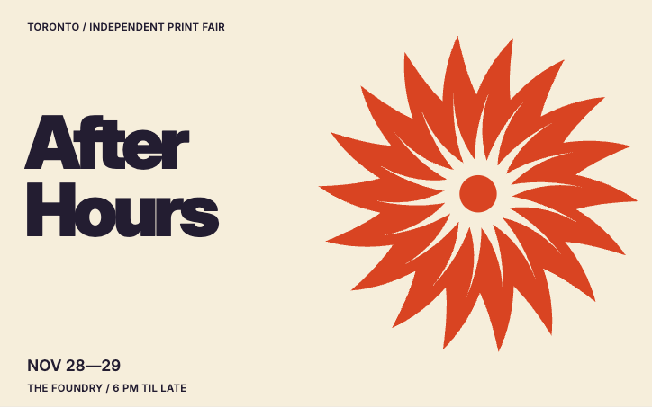

# After Hours · desktop composition

## Observation
The oversized two-line title shares the page with a single flower. Small venue and date labels stay legible around the outside.

## Adaptation
Give a landing page one dominant headline and one useful primary action. Keep secondary logistics in a separate band.
