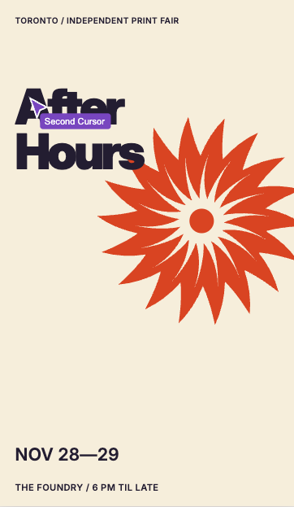

# After Hours · mobile edition

## Observation
The narrower canvas gives the headline and illustration their own reading order while keeping the date and location within reach.

## Adaptation
Stack information vertically on small screens and keep the primary action near the title.
