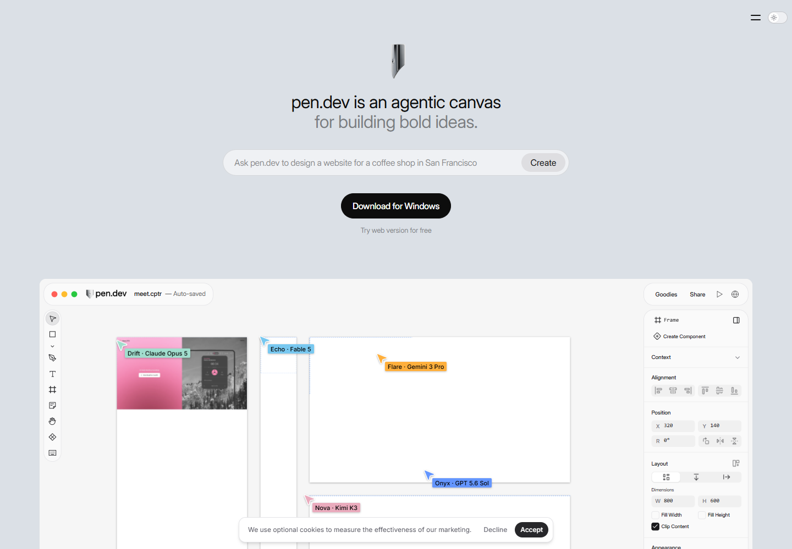
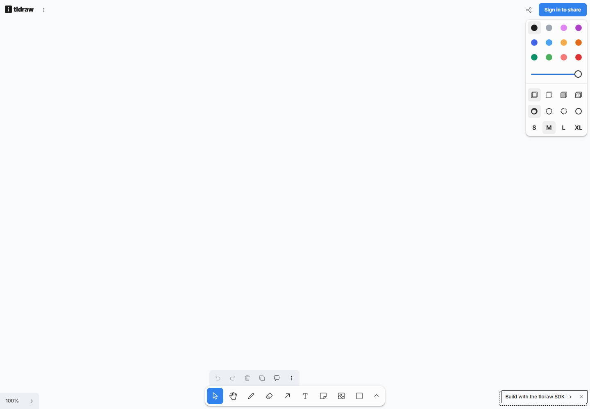
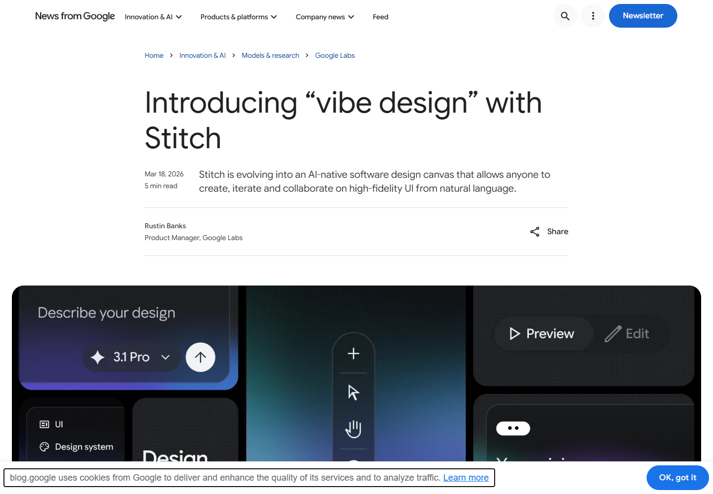

# AI Creative Workspaces

Canvas-first tools where conversation, direct manipulation and generated output coexist. Strong examples keep the artifact central, show agency and system status clearly, and let the user move fluidly between prompting and precise editing.

## Palette

| Swatch | Hex | Role |
|---|---|---|
|  | `#111216` | workspace chrome |
|  | `#F7F7F5` | canvas |
|  | `#6D5EF5` | agent action |
|  | `#3B82F6` | selection and focus |
|  | `#9CA3AF` | inactive chrome |

## Type

Compact neutral sans for controls, mono for generation status and technical output. The artifact's own typography remains independent from the surrounding tool chrome.

## Signature moves

- Infinite canvas remains the visual center; chat is a narrow companion, not the product
- Selection handles, layers and properties preserve direct control after generation
- Prompt history behaves like a reversible edit log
- Clear working states distinguish queued, generating, applied, failed and cancelled
- Variants appear side by side for visual comparison
- Contextual commands attach to the selected object rather than a global chatbot

## Best references

## Sources

- [Pen](https://www.pen.dev/)
- [tldraw](https://www.tldraw.com/)
- [Google: introducing vibe design with Stitch](https://blog.google/innovation-and-ai/models-and-research/google-labs/stitch-ai-ui-design/)
- [Adobe Firefly Boards](https://www.adobe.com/products/firefly/features/boards.html) — researched, but automated capture was blocked
- Research record: [[Web research 2026]]

## Use for

Design agents, image and video tools, whiteboards, low-code builders, diagramming, creative coding and any workflow that combines intent with editable artifacts.

## Avoid

- A giant prompt box with no direct manipulation
- Hiding what changed or making generations irreversible
- Ambiguous agent status
- Mixing document content and tool chrome into one visual hierarchy

