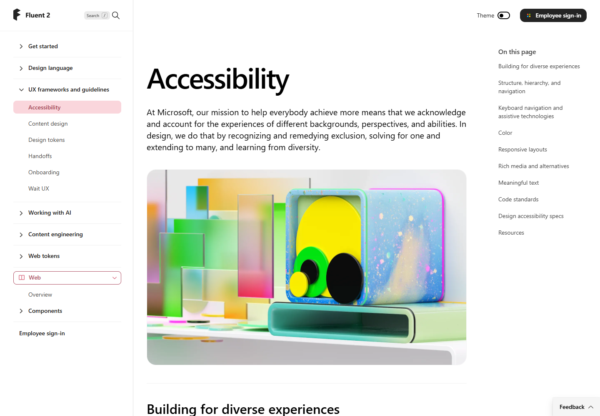
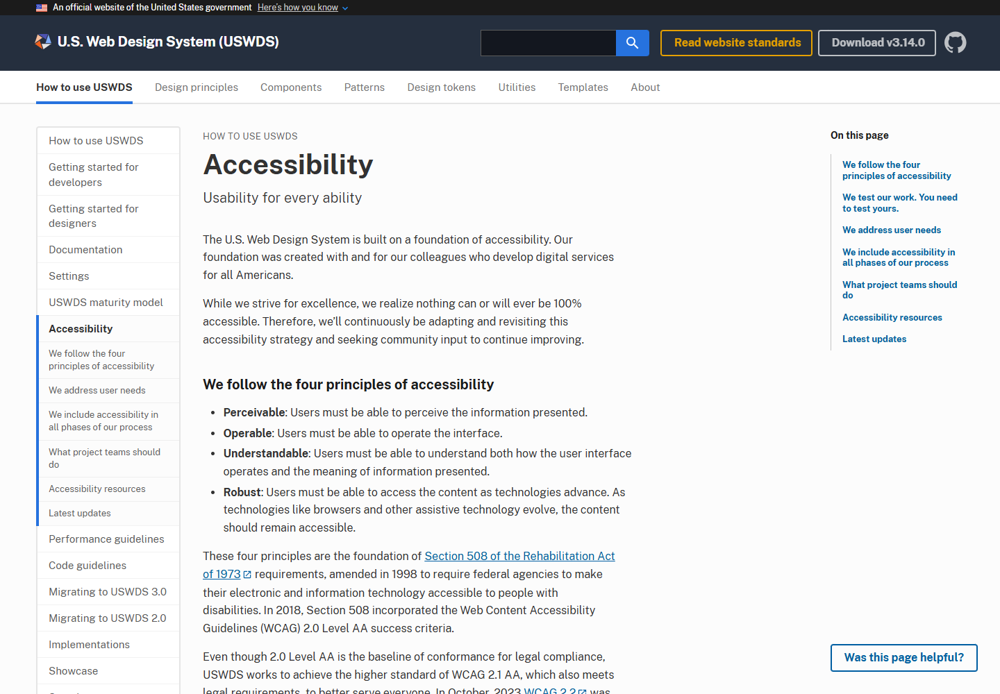
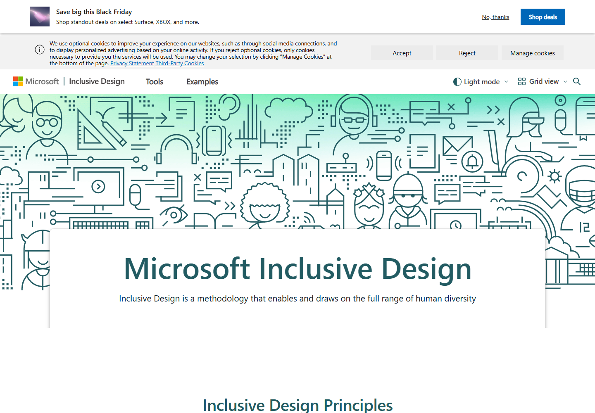

# Accessible and Inclusive UI

Accessibility expressed as a visible design quality: predictable structure, strong focus states, readable type, explicit labels, forgiving targets and alternatives for colour, motion and media. This is a systems aesthetic, not a compliance afterthought.

## Palette

| Swatch | Hex | Role |
|---|---|---|
|  | `#FFFFFF` | primary surface |
|  | `#111827` | readable ink |
|  | `#005EA8` | accessible link blue |
|  | `#FFBE2E` | warning with text/icon |
|  | `#00B7C3` | secondary cue |

## Type

Open, familiar sans with a comfortable x-height. Body copy 16-18, line height around 1.5, short measures, descriptive headings and no essential information set only in tiny labels.

## Signature moves

- Visible keyboard focus with sufficient contrast and breathing room
- Labels stay present; placeholders only provide examples
- Error messages state what happened and how to recover
- Colour is reinforced with text, icon, shape or position
- Controls have generous targets and predictable placement
- Captions, transcripts, reduced motion and adaptable text are treated as core states

## Best references

## Sources

- [Fluent 2 accessibility](https://fluent2.microsoft.design/accessibility)
- [U.S. Web Design System accessibility](https://designsystem.digital.gov/documentation/accessibility/)
- [Microsoft Inclusive Design](https://inclusive.microsoft.design/)
- Research record: [[Web research 2026]]

## Use for

Public services, healthcare, education, finance, enterprise tools, forms, safety-critical flows and products serving broad or multilingual audiences.

## Avoid

- Low-contrast minimalism
- Icon-only controls without names
- Removing focus outlines
- Motion, colour or hover as the only way to communicate state

