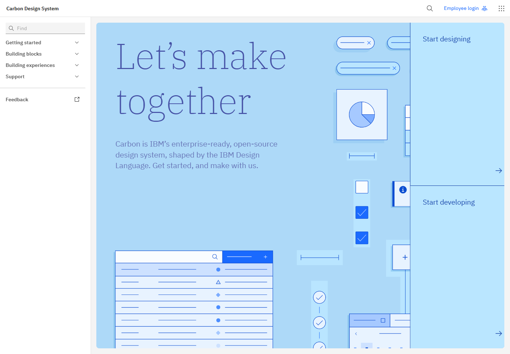
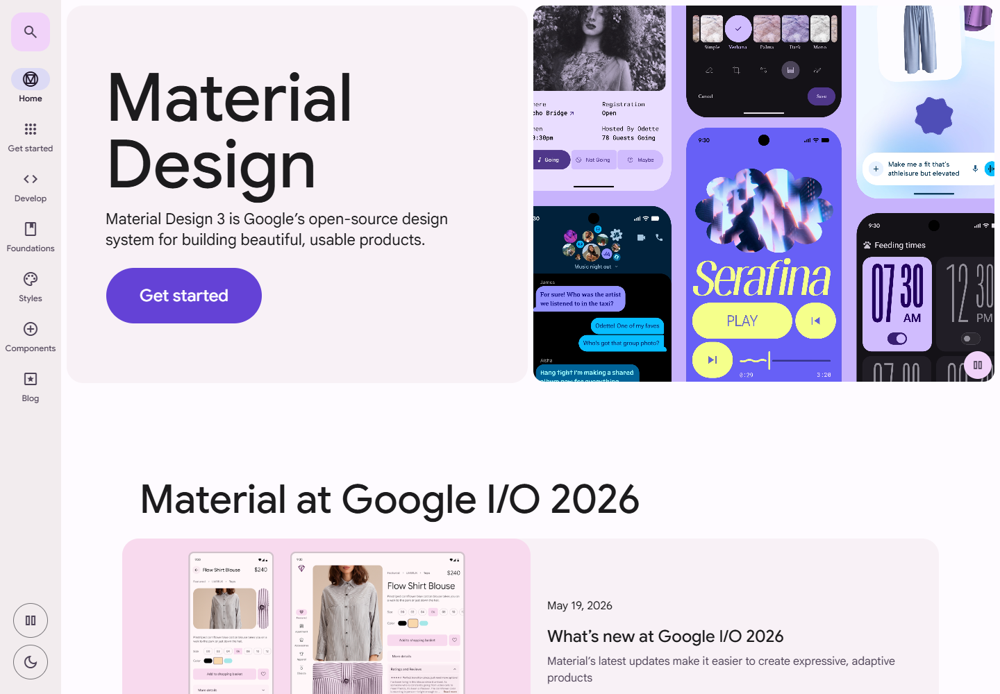
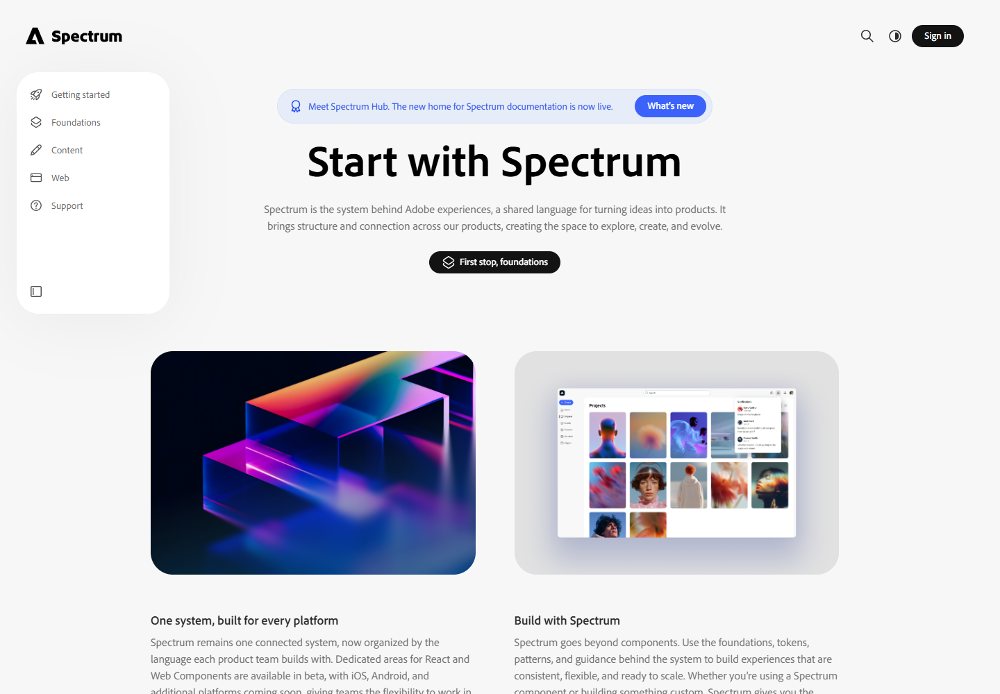

# Component Systems and States

Reference systems for designing products that remain coherent at scale. The visual value comes from tokens, state completeness, predictable density and component composition rather than a single landing-page look.

## Palette

| Swatch | Hex | Role |
|---|---|---|
|  | `#FFFFFF` | base surface |
|  | `#F4F4F4` | secondary surface |
|  | `#161616` | primary text |
|  | `#0F62FE` | action and focus |
|  | `#DA1E28` | destructive and error |
|  | `#198038` | success |

## Type

Neutral UI sans with explicit type tokens. Labels, body, helper text and data values each have stable roles; density changes spacing before it sacrifices legibility.

## Signature moves

- Every control documents default, hover, focus, active, disabled, loading and error states
- Tokens connect colour, spacing, type, radius and elevation across platforms
- Components expose anatomy, behavior, content rules and accessibility guidance
- Dense enterprise patterns use alignment and grouping instead of decorative cards
- Examples show realistic composition, not isolated components only
- Themes preserve semantic roles rather than swapping arbitrary colours

## Best references

## Sources

- [Carbon Design System](https://carbondesignsystem.com/)
- [Material 3](https://m3.material.io/)
- [Adobe Spectrum](https://spectrum.adobe.com/)
- Research record: [[Web research 2026]]

## Use for

Enterprise products, multi-platform suites, admin tools, public services, design-to-code workflows and any product maintained by multiple teams.

## Avoid

- Treating a component library as a complete product design
- Missing loading, empty, error or permission states
- Token names tied to literal colours instead of semantic roles
- Excessive variants without clear usage rules

