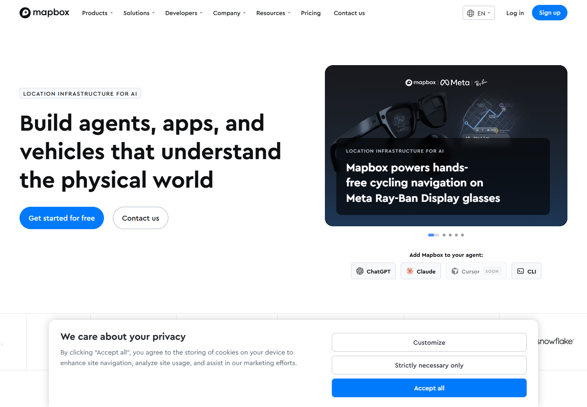
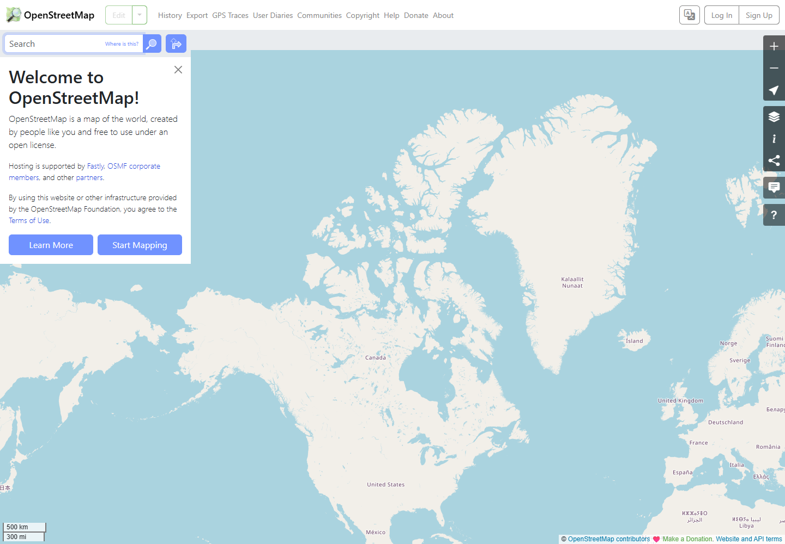
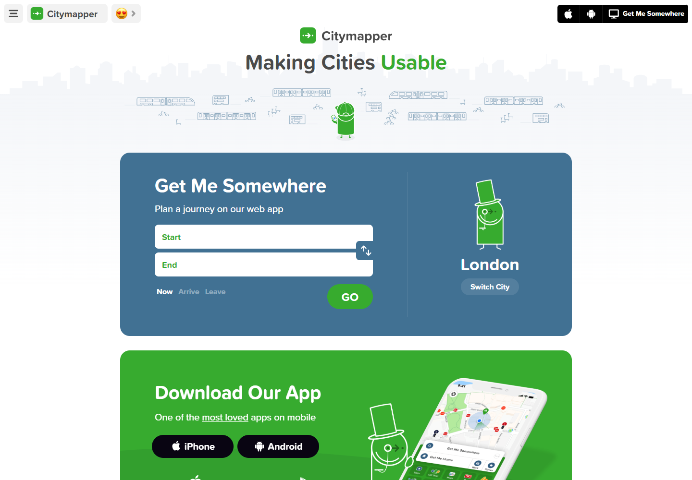

# Maps and Wayfinding

Interfaces that make place, route and movement legible under time pressure. The map is an information surface, while search, itinerary and status are layered around it with clear spatial and semantic priority.

## Palette

| Swatch | Hex | Role |
|---|---|---|
|  | `#F4F1E8` | land |
|  | `#B8D7E8` | water |
|  | `#20242A` | labels |
|  | `#2EB82E` | active route |
|  | `#3B6FF5` | current location |
|  | `#E5484D` | disruption |

## Type

Highly legible sans with tabular times and compact labels. Hierarchy prioritizes next action, direction, arrival time and disruption before secondary geographic detail.

## Signature moves

- Map detail fades beneath the active route and selected place
- Search and journey planning live in a compact, persistent sheet
- Transport modes use redundant colour, icon and text labels
- Live location, heading and uncertainty are visually distinct
- Progressive disclosure moves from overview to step-by-step instruction
- Bottom sheets and side panels preserve the map as context

## Best references

## Sources

- [Mapbox](https://www.mapbox.com/)
- [OpenStreetMap](https://www.openstreetmap.org/)
- [Citymapper](https://citymapper.com/)
- Research record: [[Web research 2026]]

## Use for

Transit, logistics, delivery, travel, outdoor activity, local discovery, fleet operations, campus navigation and live-event wayfinding.

## Avoid

- Showing every map layer at once
- Colour-only route distinctions
- Tiny tap targets on moving or mobile contexts
- Hiding arrival time and service disruption behind extra taps

