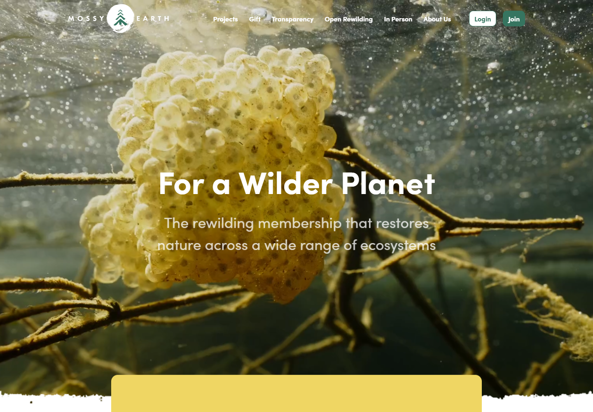
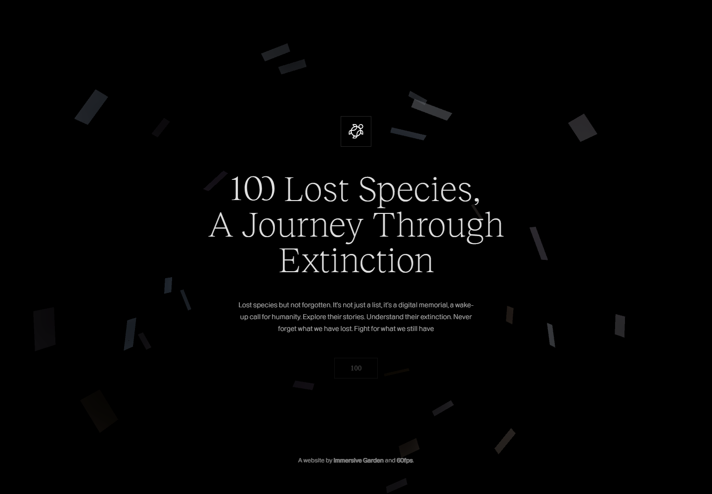

# Organic and Biophilic

Nature-led interfaces that use documentary imagery, earthy colour, irregular edges and tactile illustration to feel grounded rather than cosmetic. The best examples pair emotional photography with clear, practical information.

## Palette

| Swatch | Hex | Role |
|---|---|---|
|  | `#24382D` | forest ink |
|  | `#E8E1CB` | unbleached paper |
|  | `#A6B87A` | moss |
|  | `#D9B956` | lichen yellow |
|  | `#7A4E35` | bark brown |

## Type

Humanist sans or warm editorial serif. Headlines are plain-spoken and substantial; captions behave like field notes. Avoid overly polished luxury typography when the product needs ecological credibility.

## Signature moves

- Full-bleed documentary photography with text placed in calm negative space
- Paper, grain, torn edges, topographic lines and hand-drawn species illustrations
- Earth colours sampled from the imagery rather than generic green branding
- Narrative sections alternate evidence, human stories and measurable outcomes
- Rounded shapes feel pebble-like or botanical, not bubbly
- Maps, counters and impact data keep the storytelling concrete

## Best references

## Sources

- [Mossy Earth](https://www.mossy.earth/)
- [Allbirds](https://www.allbirds.com/)
- [100 Lost Species](https://100lostspecies.com/)
- Research record: [[Web research 2026]]

## Use for

Climate products, food and agriculture, outdoor brands, conservation, wellness, travel, material innovation and organizations that need warmth without losing rigor.

## Avoid

- Applying green to an otherwise generic SaaS layout
- Stock leaves used as decoration
- Low-contrast type over complex photography
- Sustainability claims without visible evidence or numbers

