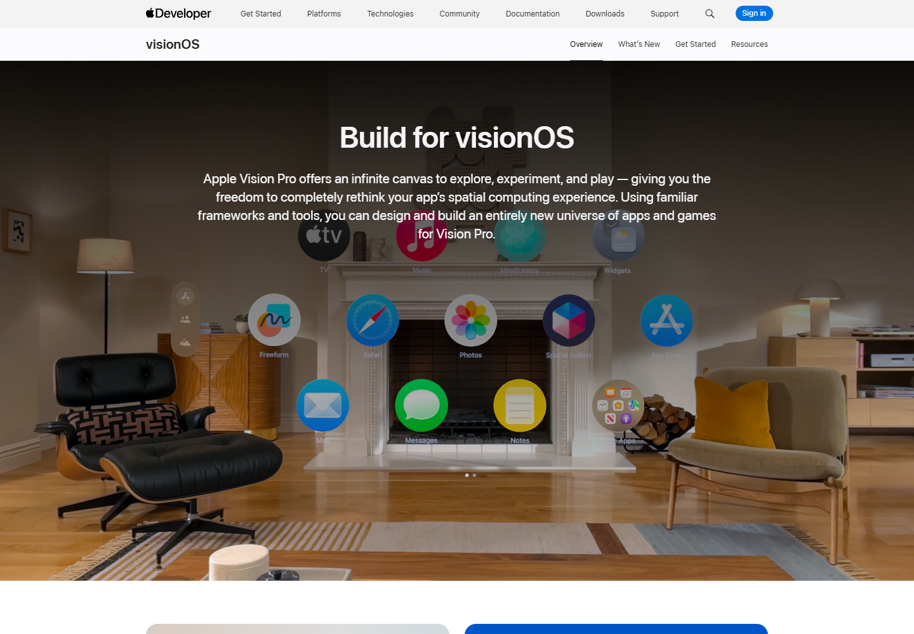
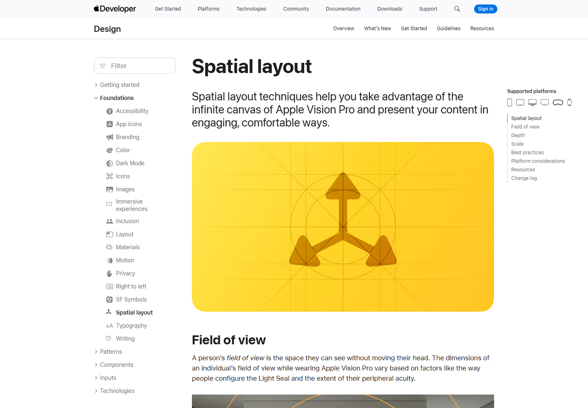
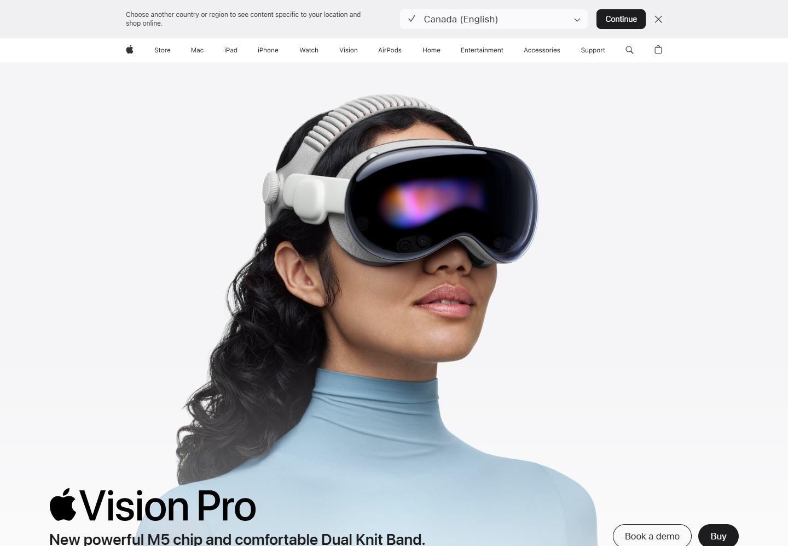

# Spatial and Cinematic Interfaces

Interfaces designed as scenes rather than flat pages. Content floats in depth, media becomes environmental, and the composition uses restrained translucency, scale, light and camera-like framing to guide attention without overwhelming the user.

## Palette

| Swatch | Hex | Role |
|---|---|---|
|  | `#0B0C10` | cinematic black |
|  | `#F5F3EF` | luminous text |
|  | `#8FA7B8` | atmospheric blue-grey |
|  | `#C9B89B` | warm environmental light |
|  | `#6B76FF` | focus accent |

## Type

Neutral system sans, usually regular or medium. Large scene titles sit far from compact utility labels. Legibility depends on generous tracking, strong contrast and avoiding dense text at depth.

## Signature moves

- Windows and controls float over a visible environment instead of filling the viewport
- A single hero object, portal or media plane establishes depth and scale
- Translucent materials borrow colour and light from the scene behind them
- Detached toolbars and tab capsules preserve the sense of open space
- Peripheral content is quieter; the focal region carries the strongest contrast
- Motion feels camera-like: slow dolly, parallax, scale and depth transitions

## Best references

## Sources

- [Apple Developer: visionOS](https://developer.apple.com/visionos/)
- [Apple HIG: Spatial layout](https://developer.apple.com/design/human-interface-guidelines/spatial-layout)
- [Apple Vision Pro](https://www.apple.com/apple-vision-pro/)
- Research record: [[Web research 2026]]

## Use for

Immersive media, spatial productivity, premium entertainment, 3D product review, cinematic landing pages and calm interfaces that need a strong sense of place.

## Avoid

- Decorative depth that hides information hierarchy
- Fast peripheral motion or controls that require large head movements
- Low-contrast glass over busy imagery
- Treating every card as a floating object

