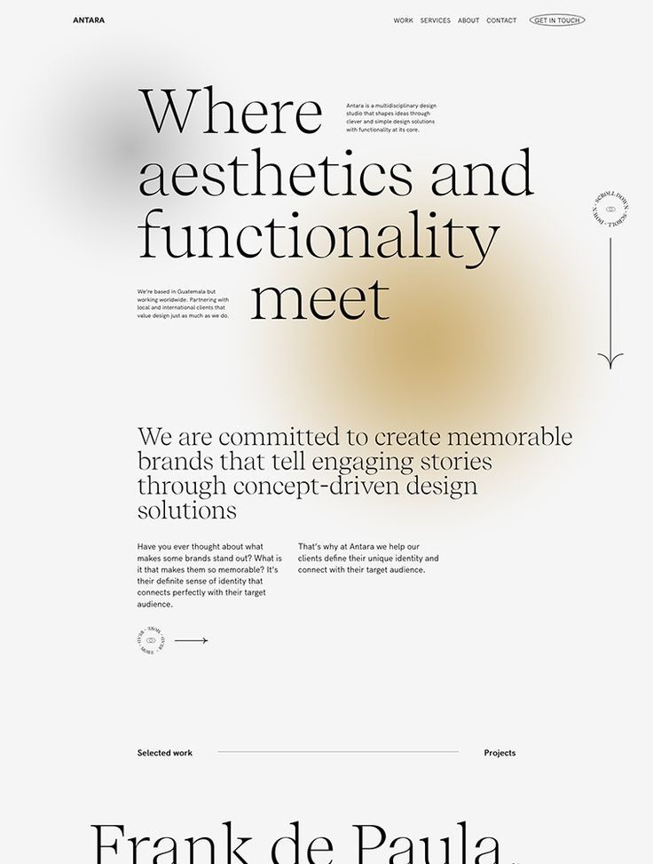
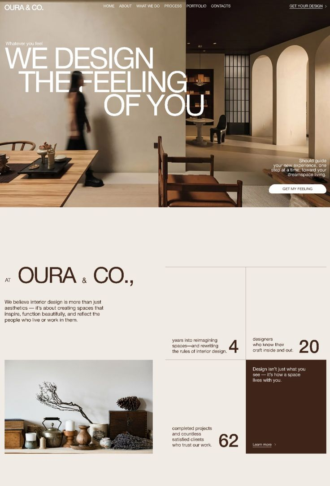
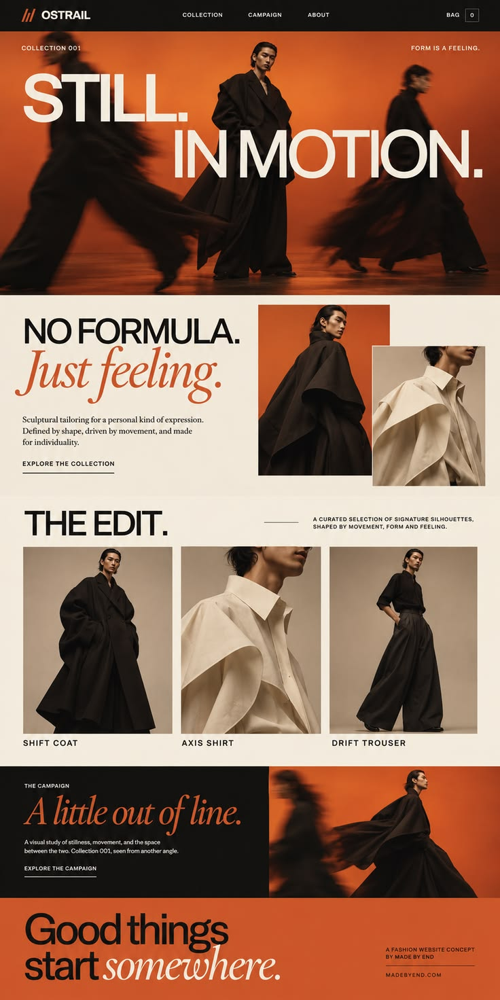

# Atelier Noir

*Editorial luxury: serif headlines, cream and photography*

## Who this designer is

A creative director from fashion and hospitality. Lets photography breathe and sets one oversized serif line per screen. (An anonymous composite persona; see [[Designers]] for the real-world research behind it.)

## Palette

| Token | Hex | Use |
|---|---|---|
| bg | `#F3EFE6` | warm cream |
| ink | `#1A1A18` | type |
| oxblood | `#6B1A1E` | accent |
| forest | `#2F4A3A` | alternative accent |
| tobacco | `#8A6A4F` | details |
| rose | `#E9A1A8` | soft highlight |

## Type

High-contrast display serif (Didone/transitional) 64-140 with italic word swaps; small grotesk or mono captions 11-12, wide tracking.

## Layout

Asymmetric magazine grid, full-bleed photos cropped at edges, thin rules, numbered sections. Lots of empty space.

## Components

- Oversized serif headline with one italic word
- Full-bleed image with a small caption block
- Minimal text nav
- Product row with tiny prices

## Motion

Slow 600-900ms fades and image parallax.

## Avoid

- Bright saturated UI colours
- Icons everywhere
- Cramped spacing

## One-line brief

Editorial luxury: warm cream canvas, huge high-contrast serif with an italic word, full-bleed photography, tiny mono captions.

## Study

[[Editorial and Luxury]] · [[Swiss Grid]]

## Reference images

