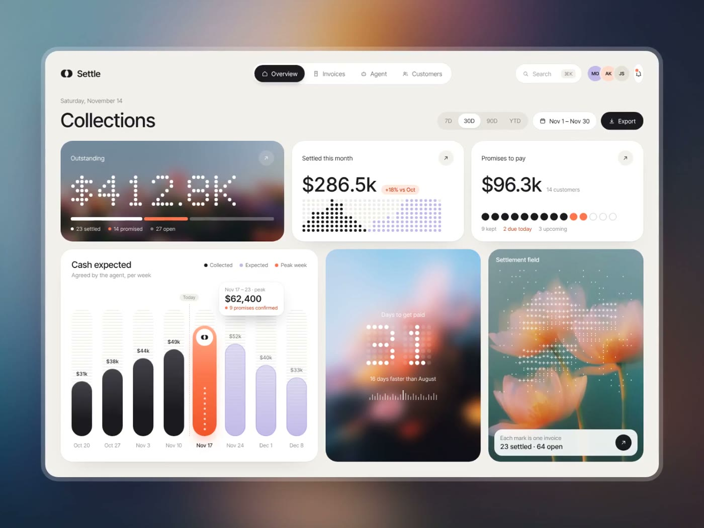
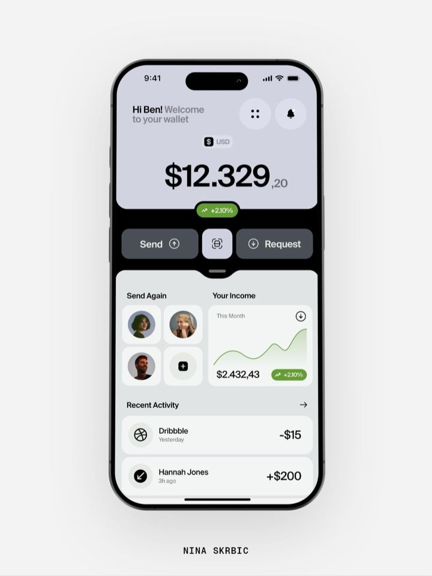
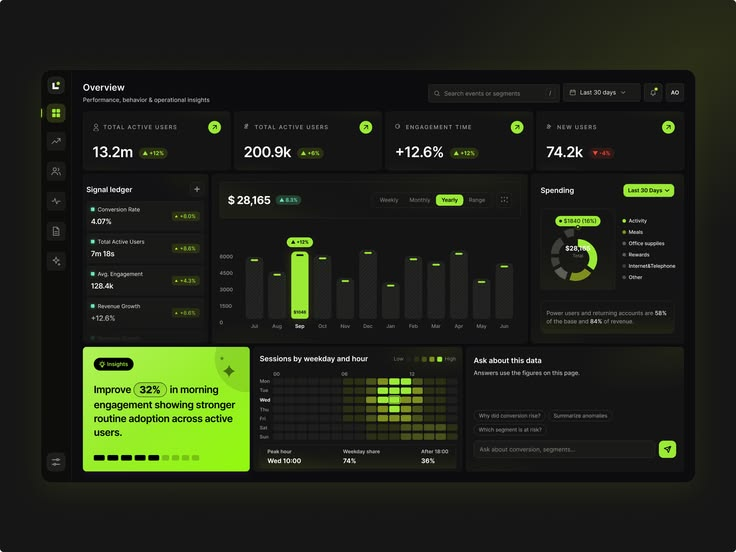

# Calm Ledger

*Calm, expensive fintech and dashboards*

## Who this designer is

A fintech designer who knows people only trust money UIs that feel finished. Calm, clear, quietly premium. (An anonymous composite persona; see [[Designers]] for the real-world research behind it.)

## Palette

| Token | Hex | Use |
|---|---|---|
| bg | `#F4F2EE` | warm grey |
| surface | `#FFFFFF` | cards |
| text | `#141414` | numbers |
| muted | `#8C8A86` | labels |
| positive | `#2E9E6A` | gains |
| accent | `#FF6A3D` | one warm highlight; dark mode lime #C8F25A |

## Type

Geometric grotesk (Inter, Manrope). KPI numerals 40-72 medium with tabular figures; dot-matrix numerals for one hero stat. Labels 12.

## Layout

Sidebar plus KPI row plus chart grid. Radius 16-20 cards, 12px gaps. Soft photo or gradient tiles for warmth.

## Components

- Hero balance with delta chip
- Bar chart with one highlighted bar and tooltip
- Transaction list with merchant logos
- Segmented period switch (D/W/M/Y)

## Motion

Numbers count up; charts grow 400ms ease-out.

## Avoid

- Neon everywhere
- Dense tables without hierarchy
- Red as a brand colour

## One-line brief

Calm premium fintech dashboard: warm grey canvas, white rounded cards, big tabular numerals, one warm accent, a highlighted bar chart.

## Study

[[Fintech and Dashboards]] · [[Liquid Glass]]

## Reference images

