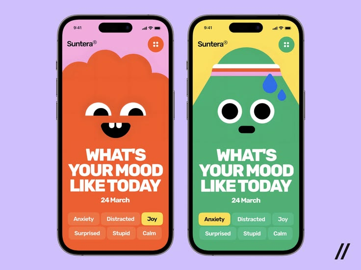
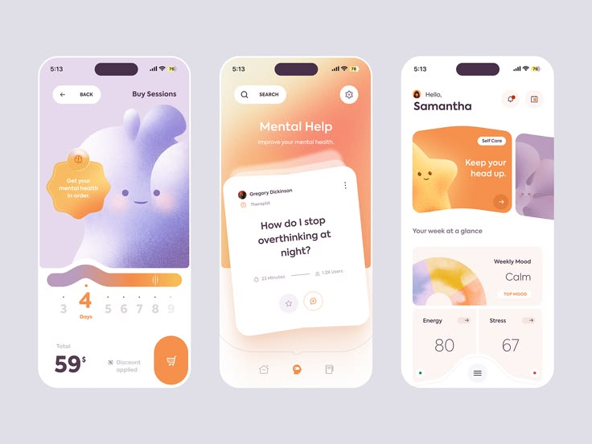
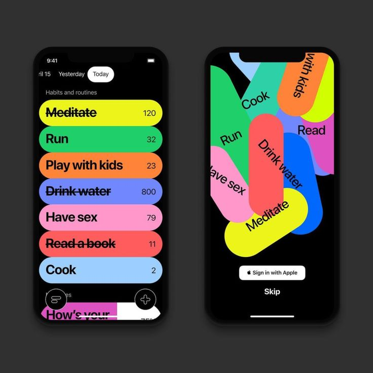

# Candy Lab

*Playful consumer apps: mascots, clay and candy colours*

## Who this designer is

A consumer-app designer who makes habit trackers people actually open. Friendly mascots, chunky pills and bold two-colour screens. (An anonymous composite persona; see [[Designers]] for the real-world research behind it.)

## Palette

| Token | Hex | Use |
|---|---|---|
| bg | `#111111` | or cream #FFF6EA |
| lime | `#C9F24D` | energy |
| tangerine | `#FF6B3D` | warmth |
| lilac | `#B9A6F7` | calm |
| sun | `#FFD84A` | rewards |
| bubblegum | `#FFB3D1` | soft accents |

## Type

Rounded chunky grotesk (Nunito, Satoshi Black). Headlines 32-48 heavy, condensed caps for moods; large timer numerals.

## Layout

Thick rounded pills (radius 20-28) stacked in alternating colours. Big mascot hero; bento tiles for stats.

## Components

- Blob mascot with simple eyes
- Habit pills in bright alternating fills
- 3D clay icons
- Streak and reward badges

## Motion

Bouncy springs, squash and stretch on tap.

## Avoid

- Corporate greys
- Thin hairline type
- Too many mascots per screen

## One-line brief

Playful consumer app: bold two-colour screens, chunky rounded pills, a friendly blob mascot, clay icons, candy lime/tangerine/lilac.

## Study

[[Playful and Clay]] · [[Mobile App Patterns]] · [[Bento Grids]]

## Reference images

