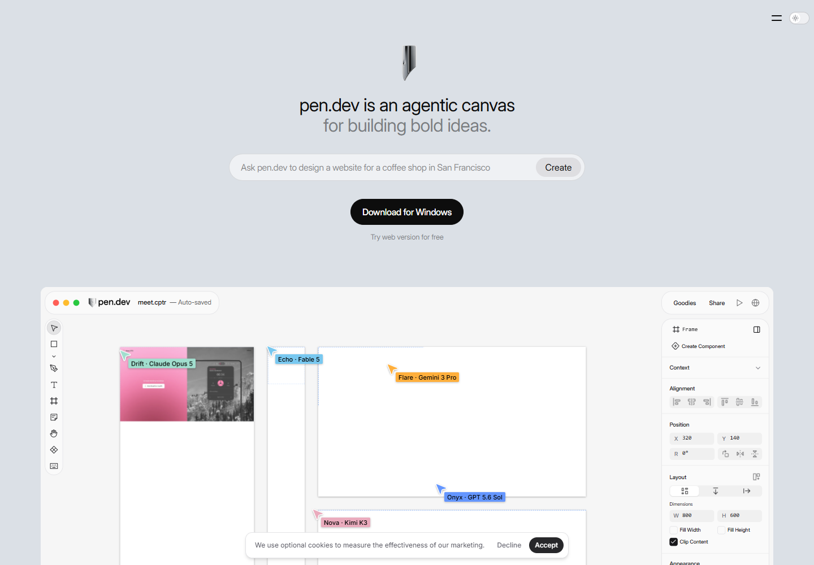
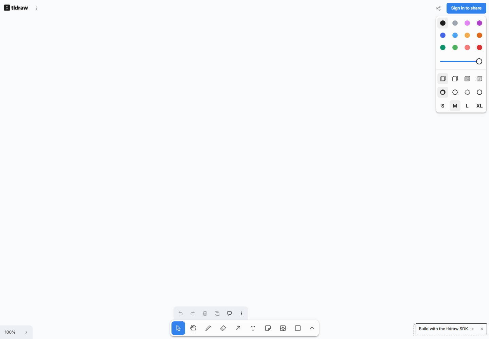
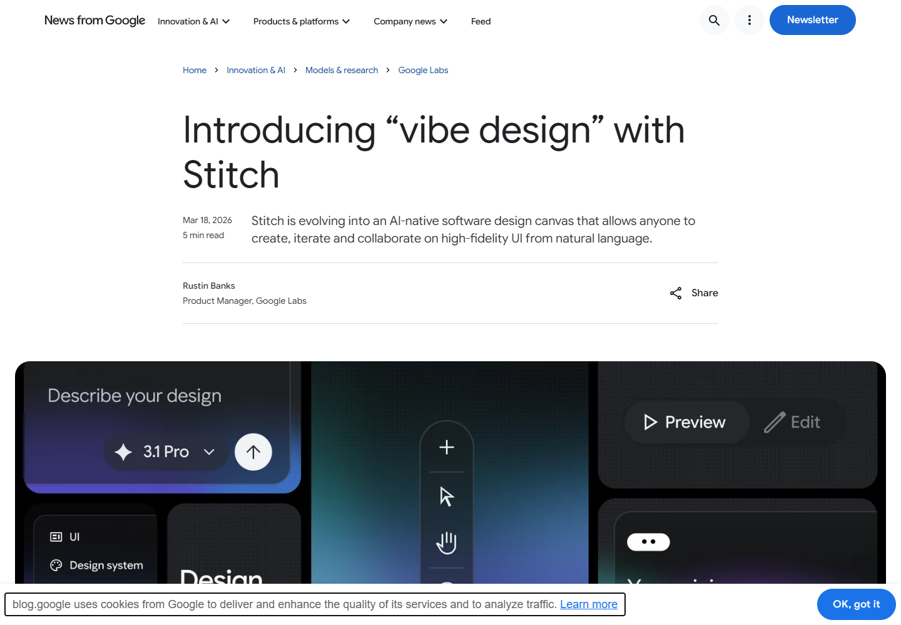

# Canvas Operator

*AI-assisted creation with visible agency and direct control*

## Who this designer is

A toolmaker who believes generation should increase control, not replace it. Keeps the artifact central and makes every agent action inspectable, reversible and editable. An anonymous composite profile.

## Palette

| Token | Hex | Use |
|---|---|---|
| chrome | `#111216` | tool shell |
| canvas | `#F7F7F5` | artifact field |
| agent | `#6D5EF5` | AI actions and status |
| selection | `#3B82F6` | direct manipulation |
| muted | `#9CA3AF` | inactive controls |

## Type

Compact neutral sans for chrome and mono for generation logs, versions and technical values. Keep created content typographically independent.

## Layout

Canvas occupies 70-85% of the workspace. Use a collapsible chat rail, compact floating tools and a contextual inspector. Variants appear in a loose spatial row.

## Components

- Prompt composer with scoped context
- Visible agent run and cancel state
- Selection toolbar attached to an object
- Variant strip with compare and accept
- Version trail with reversible edits
- Layers and property inspector

## Motion

Show work progressively but avoid fake cursor theatre. Use 150-250ms UI transitions and a clear completion state.

## Avoid

- Prompt-only interaction
- Silent mutations
- Chat covering the artifact
- Ambiguous loading animations

## One-line brief

AI creative workspace: artifact-first infinite canvas, slim conversational rail, editable outputs, explicit run states, contextual commands and reversible history.

## Study

[[AI Creative Workspaces]] · [[Component Systems and States]] · [[Minimal Tech]]

## Reference images

