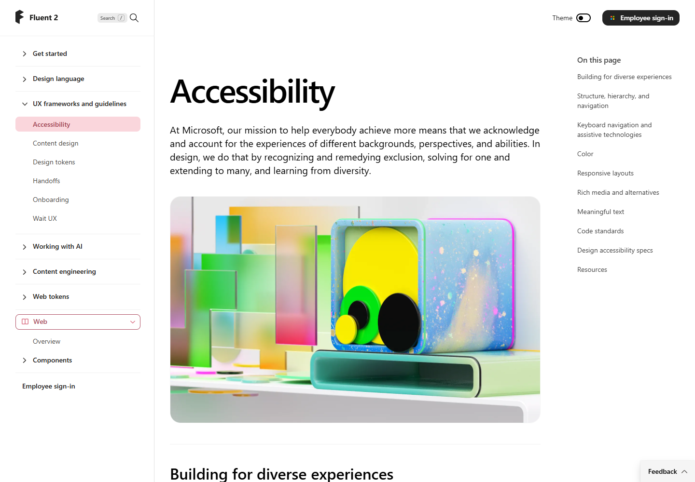
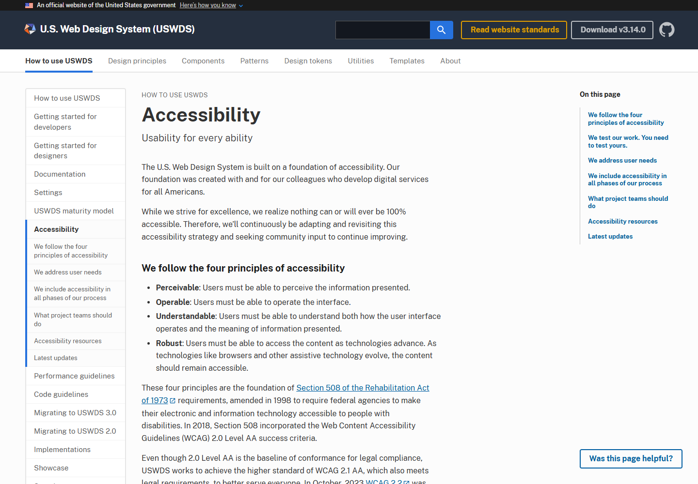
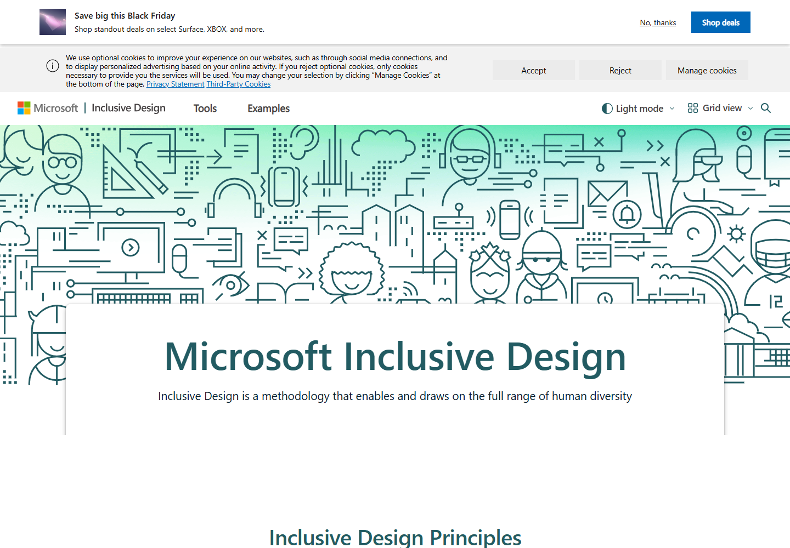

# Clear Signal

*Inclusive interfaces with explicit hierarchy and forgiving states*

## Who this designer is

A public-interest product designer who treats clarity as visual craft. Designs for keyboard, zoom, low vision, cognitive load, translation and recovery from the first wireframe. An anonymous composite profile.

## Palette

| Token | Hex | Use |
|---|---|---|
| bg | `#FFFFFF` | primary surface |
| ink | `#111827` | text |
| link | `#005EA8` | links and primary actions |
| focus | `#FFBE2E` | high-visibility focus ring |
| error | `#B50909` | error with icon and text |
| success | `#2E8540` | success with icon and text |

## Type

Open humanist sans. Body 17, line height 1.55, labels 15-16, headings descriptive rather than clever. Allow text to grow to 200% without losing content.

## Layout

Single clear reading order, 60-75 character measures, 24px section gaps and large targets. Group through headings and whitespace before cards or colour blocks.

## Components

- Persistent text label and helper copy
- Error summary linked to invalid fields
- Skip link and visible keyboard focus
- Caption/transcript and reduced-motion control
- Status message that announces change
- Large primary action with an explicit verb

## Motion

Optional and functional only. Provide reduced-motion behavior; never use movement as the sole state cue.

## Avoid

- Placeholder-only forms
- Icon-only actions
- Low-contrast grey text
- Colour-only validation

## One-line brief

Inclusive product UI: readable 17px type, explicit labels, strong focus rings, generous targets, plain-language recovery and redundant visual cues.

## Study

[[Accessible and Inclusive UI]] · [[Component Systems and States]] · [[Minimal Tech]]

## Reference images

