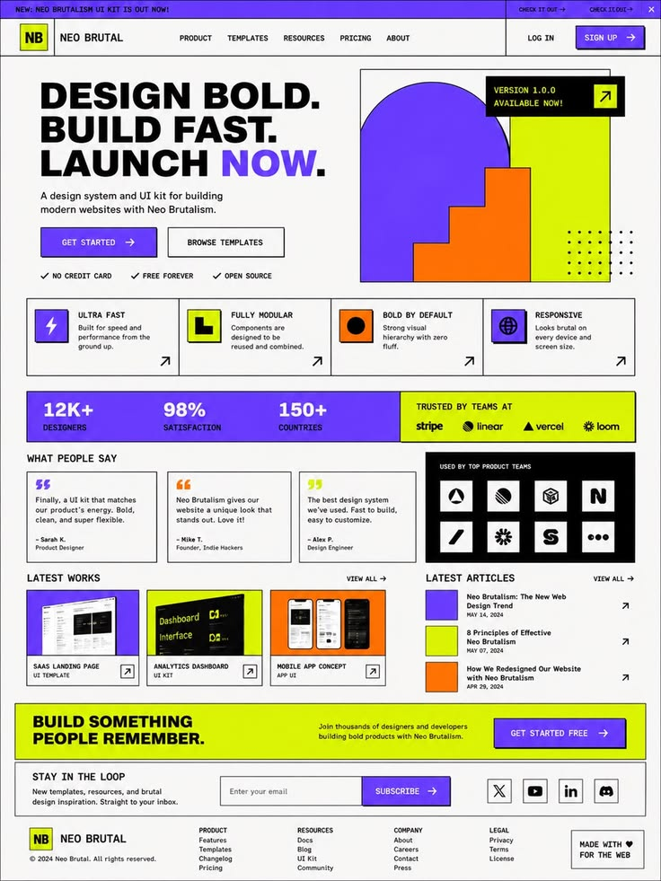
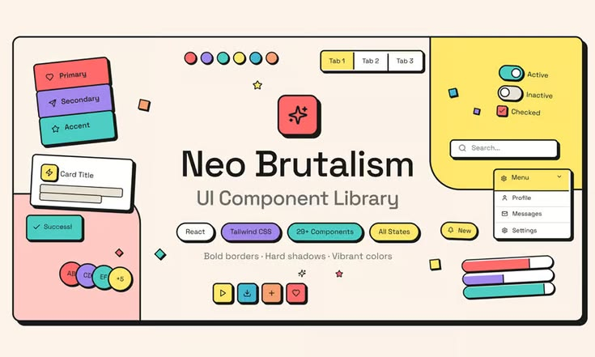
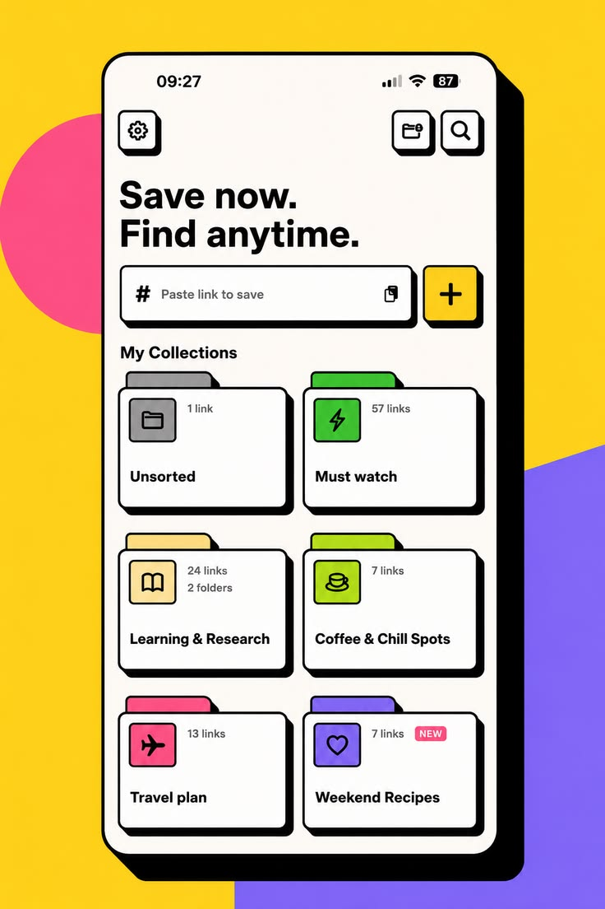

# Concrete Club

*Neo-brutalism: thick outlines, hard shadows, loud fills*

## Who this designer is

A rule-breaking product designer. Ships fast, loves stickers, outlines everything and is never boring. (An anonymous composite persona; see [[Designers]] for the real-world research behind it.)

## Palette

| Token | Hex | Use |
|---|---|---|
| bg | `#FFF7E6` | cream |
| ink | `#0A0A0A` | outlines and text |
| yellow | `#FFE14D` | primary fill |
| lilac | `#B69CF7` | secondary fill |
| pink | `#FF6FB5` | highlights |
| red | `#FF3B1F` | alerts and CTA |

## Type

Heavy condensed or wide display sans in caps (Archivo Black, Space Grotesk Bold), body 16 medium. Occasional raw Times for irony.

## Layout

2-3px black borders on every card and button, hard offset shadow (4px 4px 0 #000), radius 0-12. Dense, multi-column, visible borders.

## Components

- Buttons with a hard shadow that shifts on press
- Sticker badges and cartoon mascots
- Numbered blocks 01/02/03
- Flat colour cards, no gradients

## Motion

Snappy 100ms press-in; wobble on hover.

## Avoid

- Soft blur shadows
- Gradients
- Thin grey hairlines

## One-line brief

Neo-brutalist UI: cream background, 3px black outlines, hard offset shadows, flat yellow/lilac/pink fills, heavy condensed caps, stickers.

## Study

[[Brutalism and Neo-Brutalism]] · [[Playful and Clay]]

## Reference images

