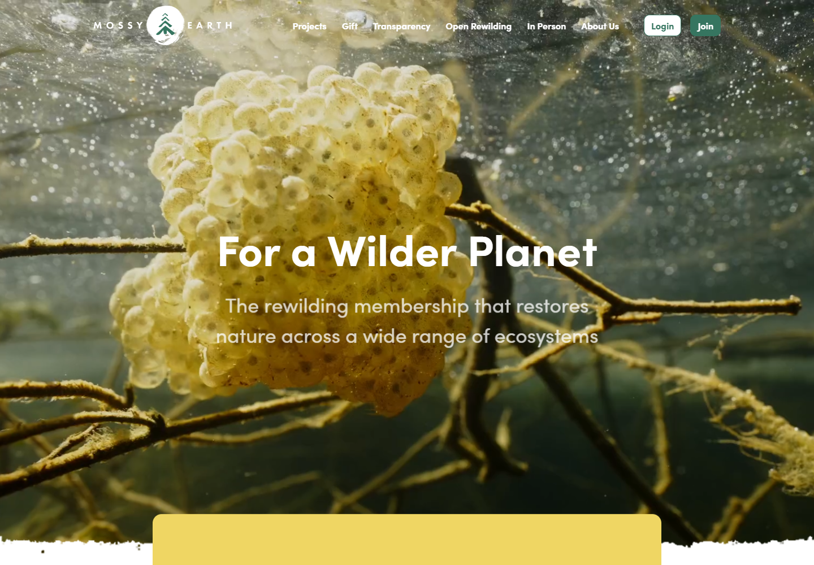
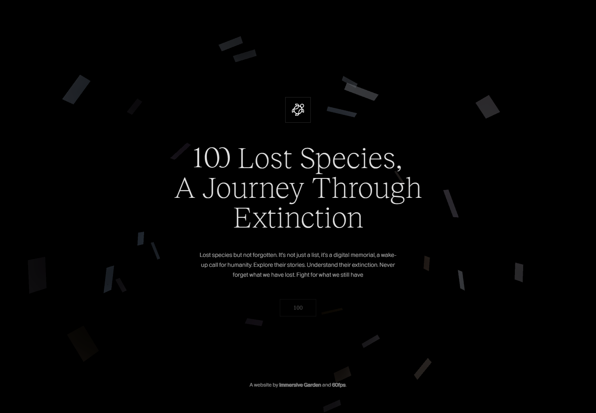

# Field Naturalist

*Documentary nature, earthy materials and evidence-led storytelling*

## Who this designer is

An editorial product designer who works like a field researcher: close observation, honest materials, useful captions and measurable outcomes. An anonymous composite profile.

## Palette

| Token | Hex | Use |
|---|---|---|
| forest | `#24382D` | ink and dark surfaces |
| paper | `#E8E1CB` | main background |
| moss | `#A6B87A` | secondary fills |
| lichen | `#D9B956` | warm accent |
| bark | `#7A4E35` | supporting detail |

## Type

Warm editorial serif for story titles paired with a humanist sans for navigation and data. Body 17-18 with relaxed leading; captions 12-13 like field notes.

## Layout

Full-bleed documentary image followed by calm text and evidence blocks. Use irregular image crops sparingly, wide margins, and alternating story/data sections.

## Components

- Field-note caption and location metadata
- Impact counter with a plain-language explanation
- Species or material card
- Topographic map or timeline
- Full-width documentary story panel

## Motion

Slow crossfades, gentle image drift and map-line drawing. Prefer natural pacing over scroll spectacle.

## Avoid

- Generic green SaaS cards
- Decorative leaf icons
- Unverifiable claims
- Text directly over busy image detail

## One-line brief

Biophilic editorial UI: documentary nature photography, unbleached paper, forest ink, field-note captions, organic crops and concrete impact data.

## Study

[[Organic and Biophilic]] · [[Editorial and Luxury]] · [[Maps and Wayfinding]]

## Reference images

