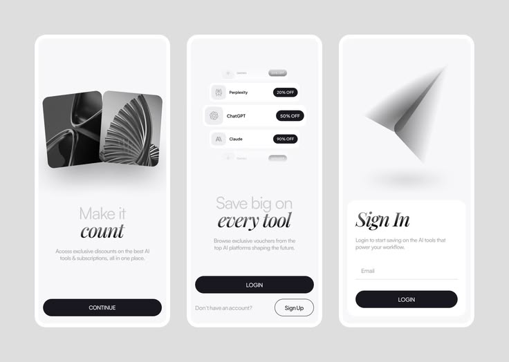
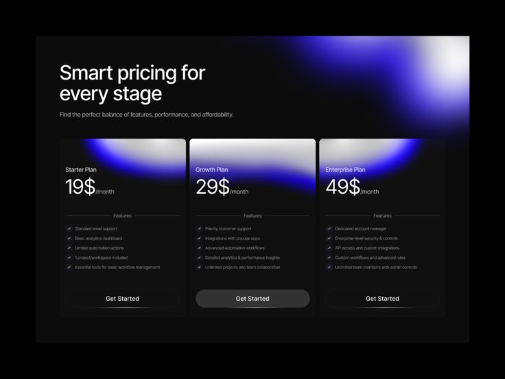
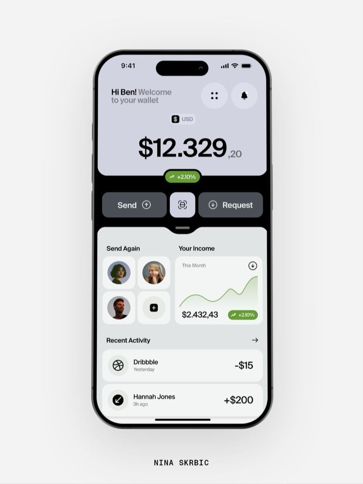

# Iris House

*Balanced, product-appropriate defaults when no vibe is named*

## Who this designer is

A senior product designer who picks the style the product needs rather than their own. Clarity first, one accent, real copy. (An anonymous composite persona; see [[Designers]] for the real-world research behind it.)

## Palette

| Token | Hex | Use |
|---|---|---|
| bg | `#FAFAF8` | warm white |
| surface | `#FFFFFF` | cards |
| text | `#16161A` | ink |
| muted | `#6B6B76` | secondary text |
| line | `#E6E4DF` | hairlines |
| accent | `#3B5BFF` | one brand accent; pick per product |

## Type

Inter or a neutral grotesk. Display 40-56 semibold with -2% tracking, body 15-16 regular, labels 12-13 medium. One family, three weights at most.

## Layout

8px spacing scale (8/12/16/24/32/48). 12-col desktop, 4-col mobile, 20-24px mobile gutters. Radius 12 cards, 999 pills.

## Components

- One clear primary action per screen
- Cards only where grouping helps; otherwise whitespace and hairlines
- Realistic, specific copy and numbers
- Bottom tab bar on mobile, left rail on desktop

## Motion

150-250ms ease-out; nothing decorative.

## Avoid

- More than one accent colour
- Gradients and glows for their own sake
- Lorem ipsum or generic "Dashboard" titles

## One-line brief

Clean, confident product UI with one accent, strong hierarchy and generous whitespace.

## Study

[[Minimal Tech]] · [[Mobile App Patterns]] · [[Fintech and Dashboards]]

## Reference images

