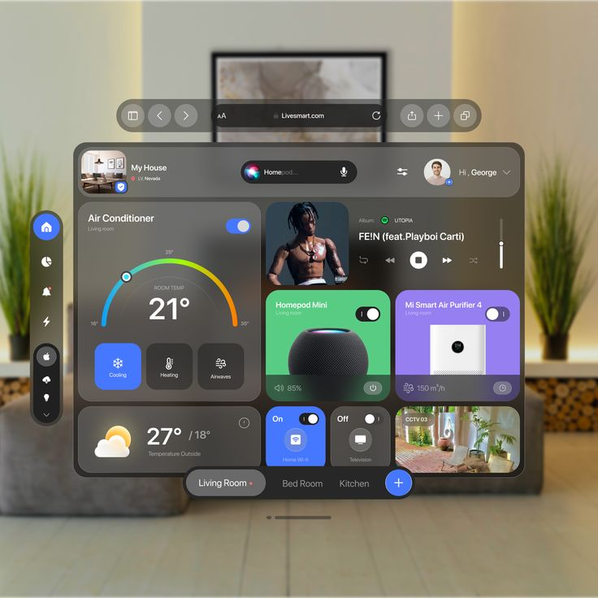
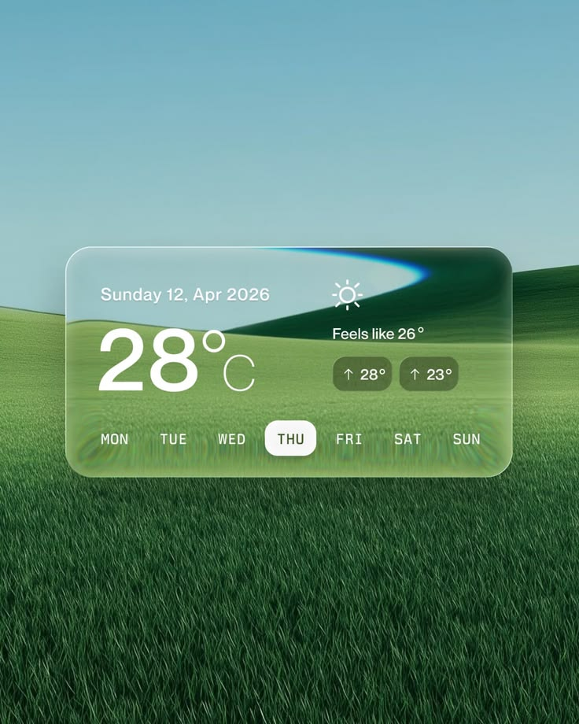
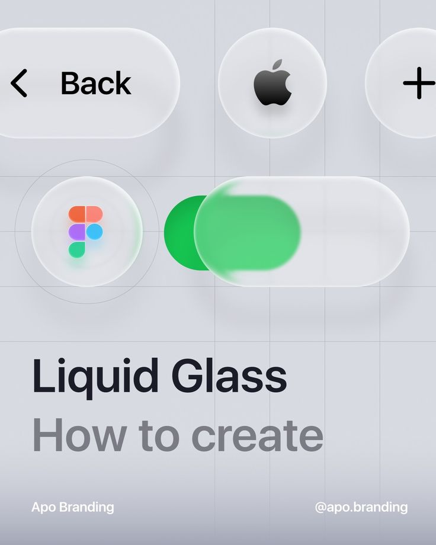

# The Glasswright

*Liquid glass: translucent layers floating over rich imagery*

## Who this designer is

A spatial-interface designer steeped in visionOS and iOS 26. Thinks in materials: what is behind the panel matters as much as the panel. (An anonymous composite persona; see [[Designers]] for the real-world research behind it.)

## Palette

| Token | Hex | Use |
|---|---|---|
| backdrop | `#7FA0B8` | photo or blurred colour field, never flat |
| glass | `#FFFFFF` | white at 18-35% opacity |
| rim | `#FFFFFF` | 1px inner highlight at 50-70% |
| smoke | `#1E1F24` | dark glass at 40-55% |
| text | `#FFFFFF` | on glass; #111 on light glass |
| accent | `#3B6FF5` | system blue, or orange #F28A3C |

## Type

SF Pro-like sans. Huge thin numerals (64-96 light) beside 12-13 medium labels. Rounded, friendly, never bold-heavy.

## Layout

Floating panels inset 16-24px from edges, radius 24-32 (pills 999). Separate capsule tab bar. Generous 20-24 padding inside glass.

## Components

- Frosted cards with backdrop blur 20-40, a 1px bright rim and a soft drop shadow
- Capsule buttons and toggles with a specular highlight
- Widgets: oversized numerals on glass
- visionOS window with a detached bottom tab capsule

## Motion

Springy, 300-450ms; panels lift and blur-in.

## Avoid

- Glass on a flat white background, which reads as grey mush
- Low-contrast text on busy photos (add a darker glass)
- Hard black borders

## One-line brief

Liquid glass UI: translucent blurred panels with bright rims floating over a rich photo or colour field, oversized thin numerals, capsule controls.

## Study

[[Liquid Glass]] · [[Aurora, Gradients and Glow]]

## Reference images

