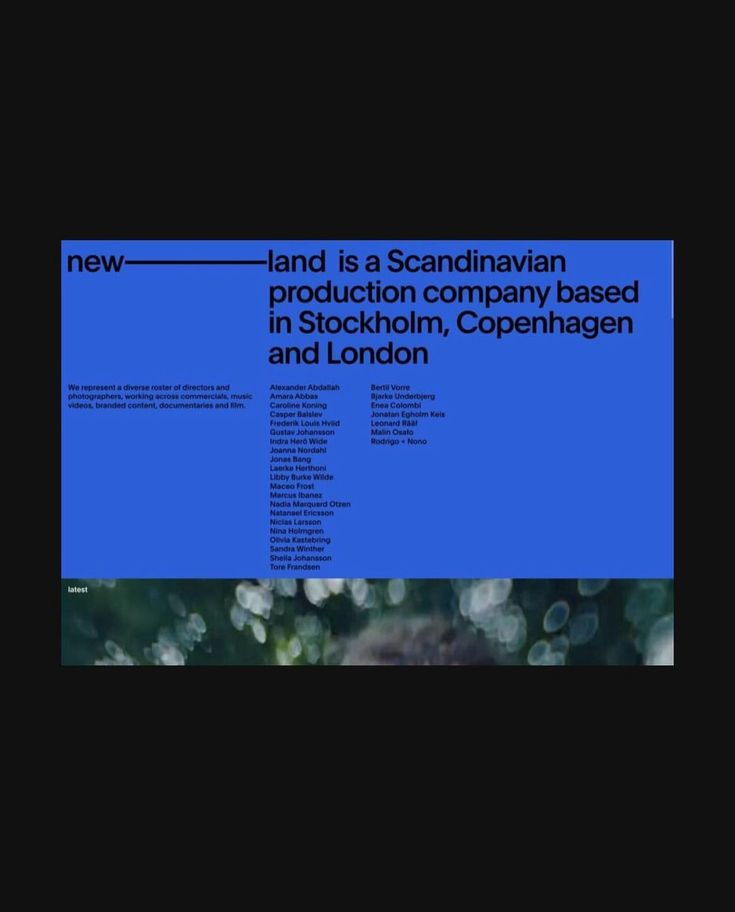
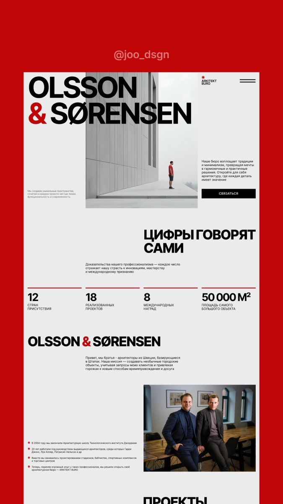
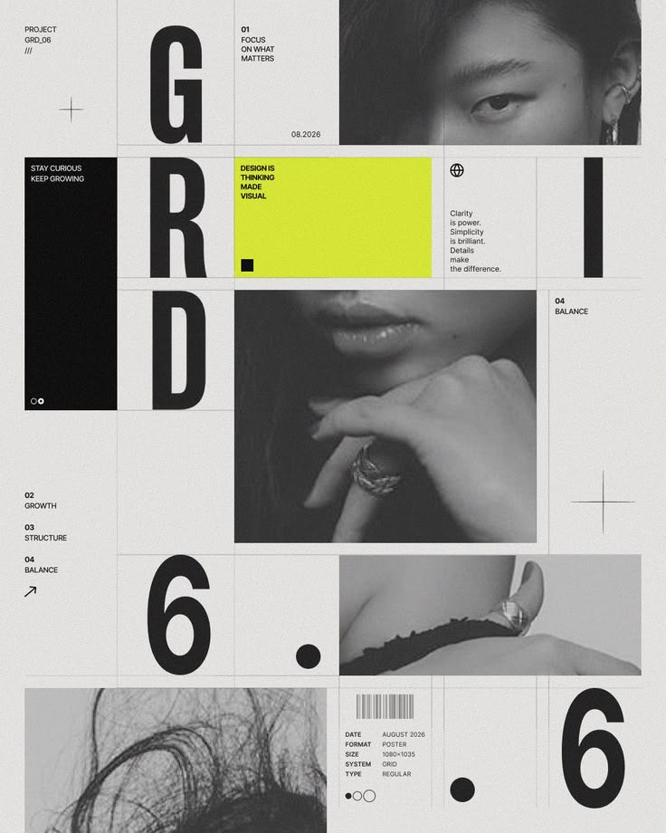

# Grid Purist

*Swiss International Style: grids, grotesk and one red*

## Who this designer is

A typographer who believes the grid is the design. Asymmetric, flush-left, ruthless about hierarchy. (An anonymous composite persona; see [[Designers]] for the real-world research behind it.)

## Palette

| Token | Hex | Use |
|---|---|---|
| bg | `#FFFFFF` | or warm paper #EDEAE2 |
| ink | `#0A0A0A` | type |
| red | `#E62B1E` | the one accent |
| blue | `#2F4BE8` | alternative accent |
| grid | `#D9D6CF` | visible grid lines |
| muted | `#6F6B63` | captions |

## Type

Neue Haas / Helvetica-like grotesk. Headlines 80-160 bold, leading 0.9, hard word breaks. Captions 11-12 mono or sans. Extreme scale contrast.

## Layout

Visible 12-col modular grid; content snaps to it. Flush-left, ragged right. Numbered sections, coordinates and dates as metadata.

## Components

- Giant headline cropped by the frame
- Single flat accent block
- Index lists with numbers and thin rules
- Photo in a grid cell, sometimes dithered

## Motion

Minimal: hard cuts, line-by-line reveals.

## Avoid

- Centred layouts
- Rounded cards and shadows
- More than one accent

## One-line brief

Swiss grid: visible modular grid, huge flush-left grotesk headline, black and white with one red block, numbered mono metadata.

## Study

[[Swiss Grid]] · [[Editorial and Luxury]]

## Reference images

