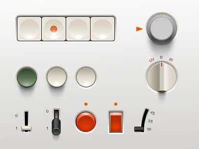
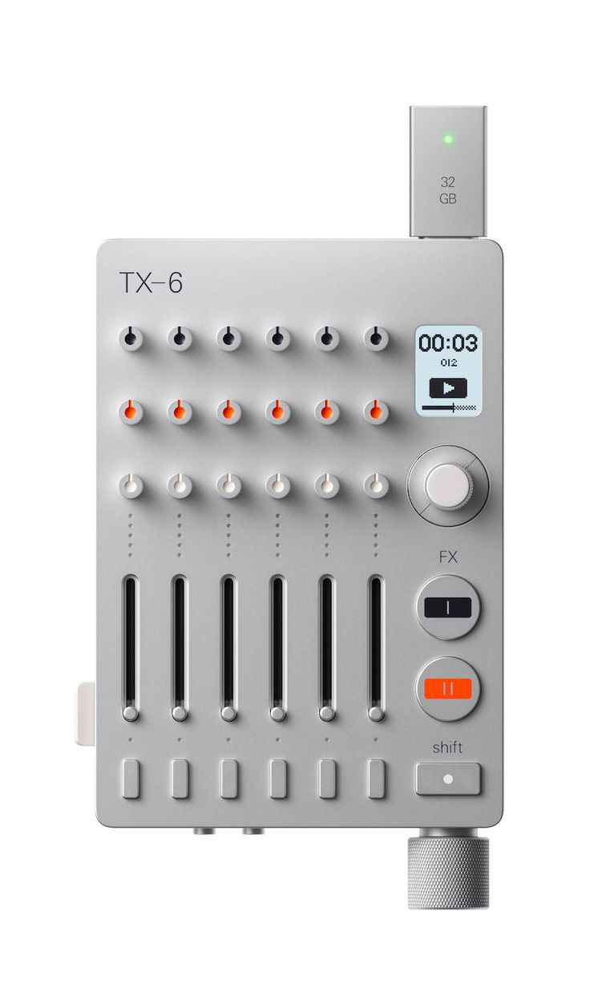
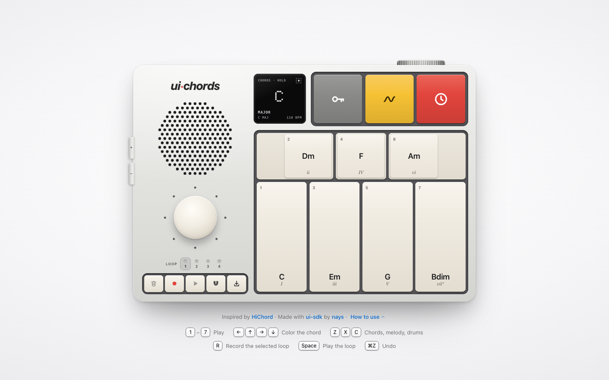

# Knob & Switch

*Tactile hardware UI: knobs, faders and soft plastic*

## Who this designer is

An industrial designer turned UI designer. Wants every control to feel like it clicks: rotary knobs, rocker switches, LEDs, labelled glyphs. (An anonymous composite persona; see [[Designers]] for the real-world research behind it.)

## Palette

| Token | Hex | Use |
|---|---|---|
| body | `#E6E7EA` | soft plastic grey |
| panel | `#F5F4F0` | off-white |
| graphite | `#2A2B2E` | screens and type |
| orange | `#FF5A1F` | the one accent |
| yellow | `#F2C94C` | secondary key |
| led | `#3DDC6A` | status LED |

## Type

Tight technical sans (Inter Tight / Helvetica) with tiny all-caps labels 9-11. LCD or dot-matrix face on the screen.

## Layout

Instrument-panel grid of square keys and modules. Radius 10-18 on keys, 24-32 on the device body. Inner and outer soft shadows.

## Components

- Rotary knob with tick marks
- Chunky square keys in a grid with tiny labels
- Small LCD readout
- Speaker grille dot pattern
- Slide faders and meters

## Motion

Physical: 80-120ms press with a 1-2px depress and shadow change.

## Avoid

- Flat web buttons
- Glassmorphism
- Long text blocks

## One-line brief

Tactile hardware-inspired UI: soft grey plastic body, square labelled keys, rotary knob, small LCD screen, one orange accent, soft inner shadows.

## Study

[[Tactile and Skeuomorphic]] · [[Retro OS and Y2K]]

## Reference images

