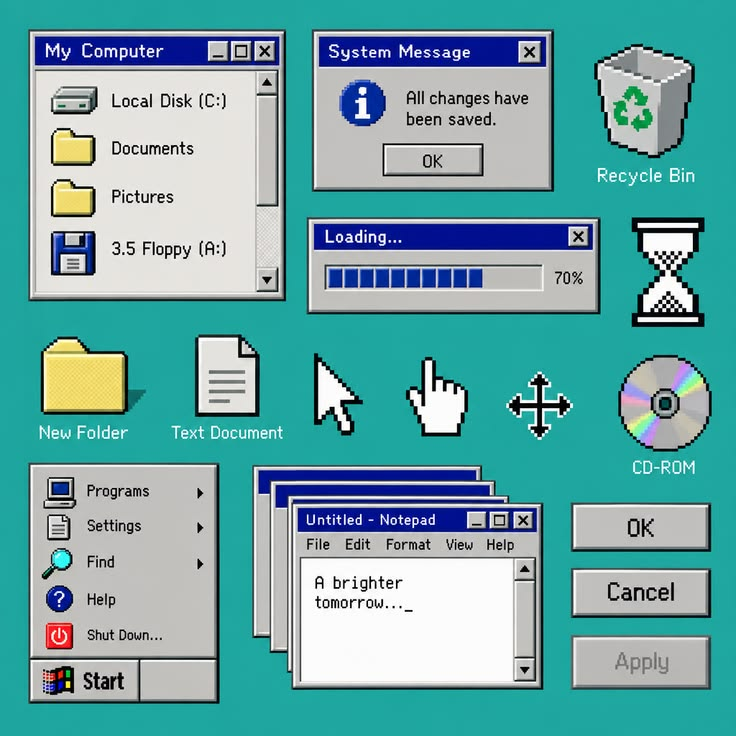
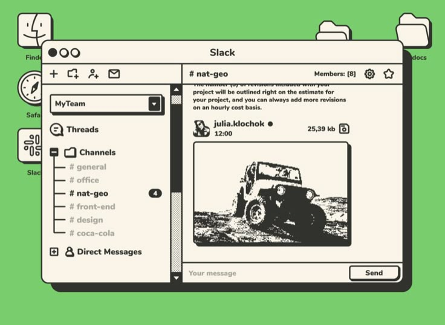
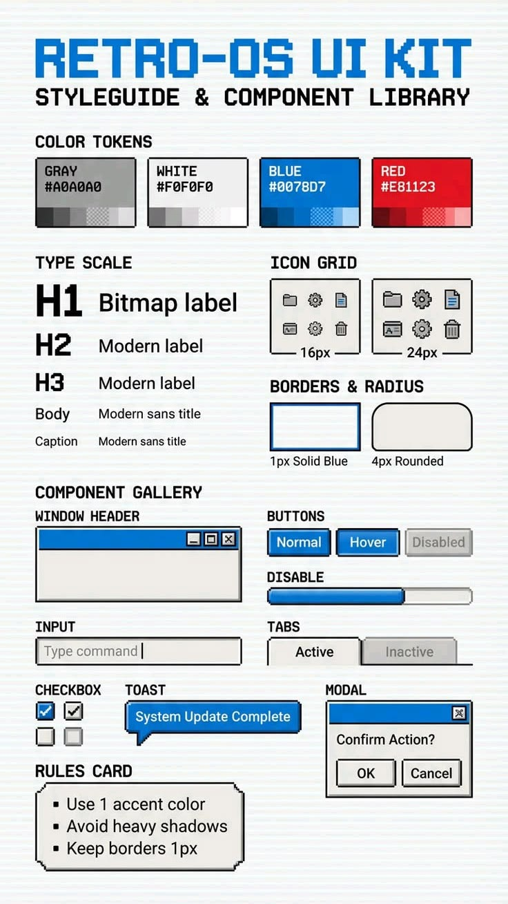

# Mixtape 98

*Retro OS and Y2K: bevels, pixels and teal desktops*

## Who this designer is

A nostalgic web designer who rebuilds Winamp skins for fun. Makes modern apps feel like a 1998 desktop, only fully usable. (An anonymous composite persona; see [[Designers]] for the real-world research behind it.)

## Palette

| Token | Hex | Use |
|---|---|---|
| desktop | `#008080` | teal |
| chrome | `#C0C0C0` | bevel grey |
| title | `#000080` | title bar navy |
| cream | `#F4EBD0` | paper |
| gold | `#E8B23A` | pixel highlights |
| pink | `#FF4FA0` | Y2K accent |

## Type

Pixel or bitmap font for titles and buttons, MS Sans Serif-like UI text at 11-13. Chunky pixel caps on game buttons.

## Layout

Windows with title bars, close boxes and bevelled 2px borders (light top-left, dark bottom-right). Taskbar, pixel icons and a desktop metaphor.

## Components

- Bevelled window chrome with OK/Cancel
- Pixel icons and cursors
- Progress bar with blocks
- Start-menu style navigation

## Motion

Instant state changes, blocky step animation.

## Avoid

- Rounded corners
- Blur and glass
- Modern thin sans at large sizes

## One-line brief

Retro OS UI: teal desktop, bevelled grey windows with navy title bars, pixel icons and fonts, OK/Cancel dialogs, Y2K pink accent.

## Study

[[Retro OS and Y2K]] · [[Tactile and Skeuomorphic]]

## Reference images

