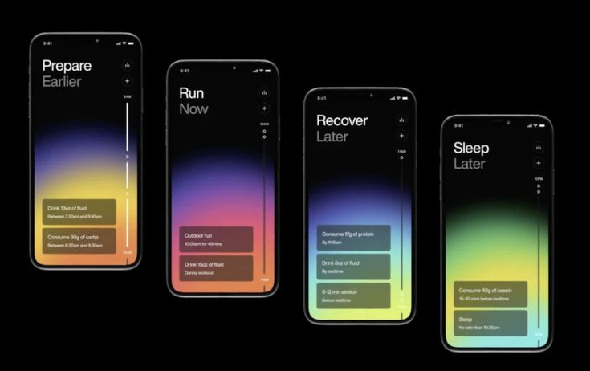
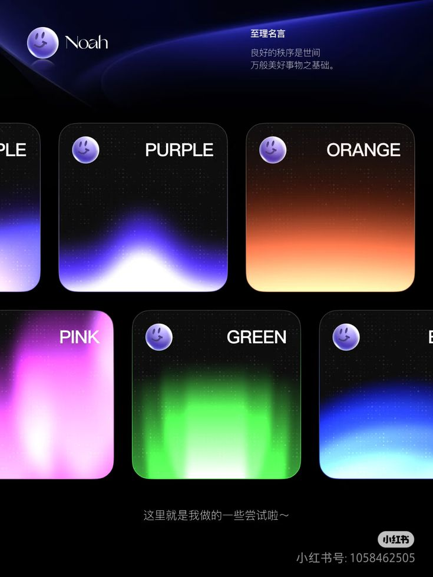
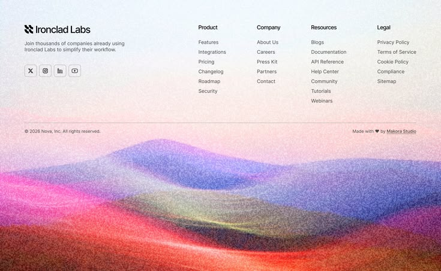

# Night Bloom

*Dark interfaces lit by aurora gradients and grain*

## Who this designer is

A brand-led UI designer for AI and music products. Black canvases, one luminous bloom, film grain and white type. (An anonymous composite persona; see [[Designers]] for the real-world research behind it.)

## Palette

| Token | Hex | Use |
|---|---|---|
| bg | `#05060C` | deep black |
| blue | `#2A3BFF` | bloom |
| violet | `#B44CFF` | bloom |
| pink | `#FF5FA2` | bloom |
| orange | `#FF8A3D` | sunset edge |
| text | `#F5F5F7` | type |

## Type

Clean grotesk, light or regular, white on dark; wide-tracked display caps for wordmarks. Mono captions.

## Layout

Centred hero over a large blurred radial bloom; cards with gradient fills inside; film grain overlay at 4-8% opacity.

## Components

- Blurred colour bloom behind the headline
- Dark cards with inner gradient fills
- Gradient footer band fading out
- Pill buttons in white

## Motion

Slow-drifting gradients (8-15s), glow on hover.

## Avoid

- Rainbow overload (two or three hues max)
- Flat untextured gradients
- Light mode

## One-line brief

Dark UI lit by a soft aurora bloom (blue, violet, pink) with film grain, white light grotesk, gradient-filled dark cards.

## Study

[[Aurora, Gradients and Glow]] · [[Minimal Tech]]

## Reference images

