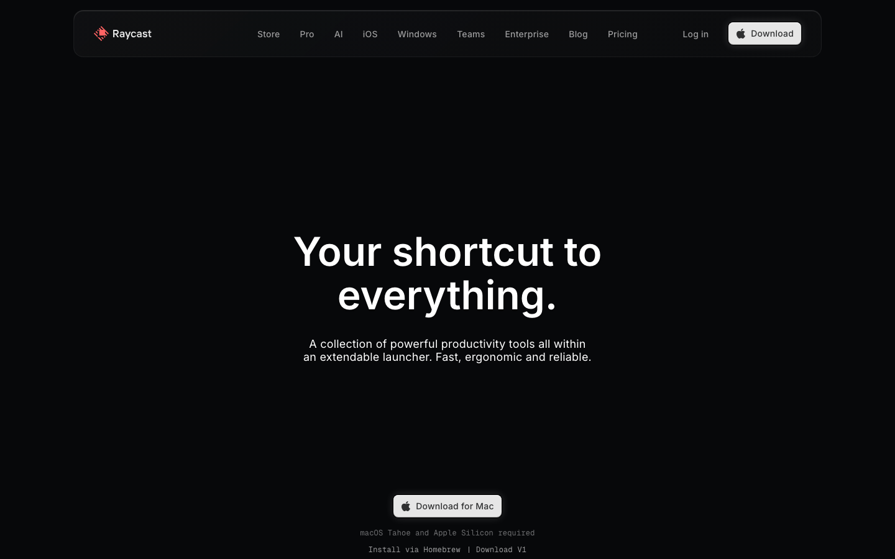
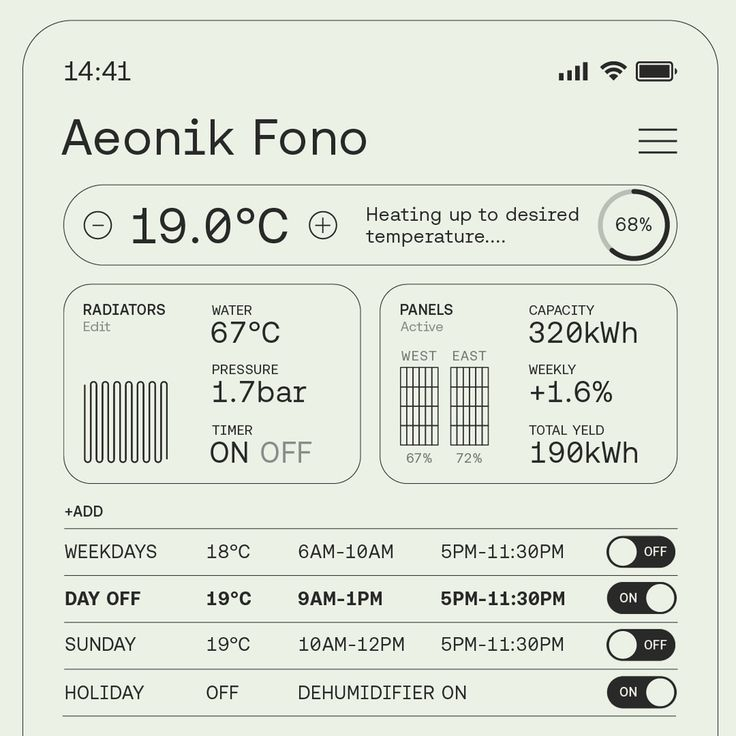

# The Quiet Engineer

*Developer-tool minimalism: dark, precise, one glow*

## Who this designer is

A design engineer from the dev-tools world: obsessive about 1px borders, keyboard shortcuts and copy that says exactly what it does. (An anonymous composite persona; see [[Designers]] for the real-world research behind it.)

## Palette

| Token | Hex | Use |
|---|---|---|
| bg | `#0A0B10` | near-black |
| surface | `#111318` | raised panels |
| line | `#23262F` | 1px borders |
| text | `#EDEEF0` | primary |
| muted | `#8A8F98` | secondary |
| accent | `#5E6AD2` | indigo; or lime #D7F25A for one CTA |

## Type

Inter or Geist for UI, Geist Mono for code and numbers. Display 48-64 semibold, -3% tracking. Labels 12-13.

## Layout

Centred 1100-1200px column. Hairline-bordered cards, radius 8-12. Dense but aligned; 4px base grid.

## Components

- Command palette and kbd hints (⌘K)
- Single soft radial glow behind the hero
- Mono spec rows: label, value, unit
- Changelog-style lists with dates

## Motion

Fast and subtle: 120-200ms, opacity and 4px translate.

## Avoid

- Multiple bright colours
- Illustrations with faces
- Rounded bubbly shapes

## One-line brief

Dark developer-tool minimalism: near-black surfaces, 1px borders, Inter plus mono numbers, one soft indigo glow, keyboard-first details.

## Study

[[Minimal Tech]] · [[Aurora, Gradients and Glow]]

## Reference images

