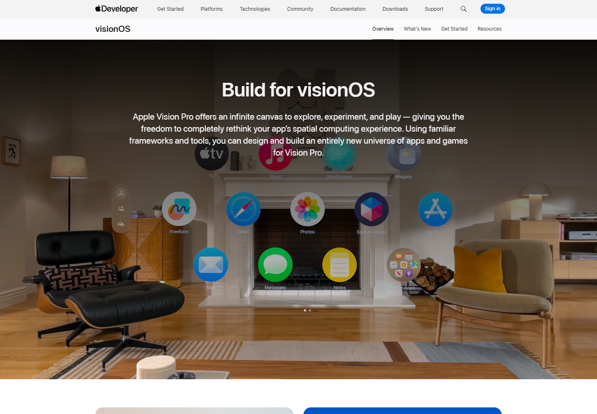
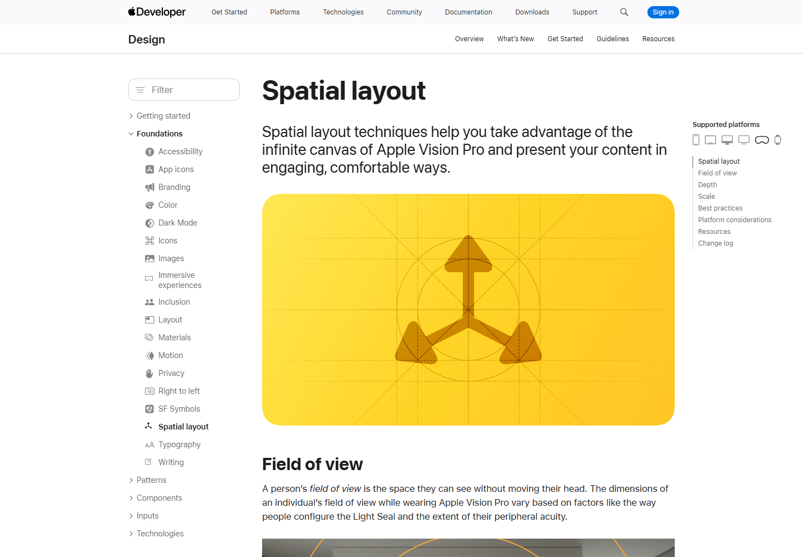
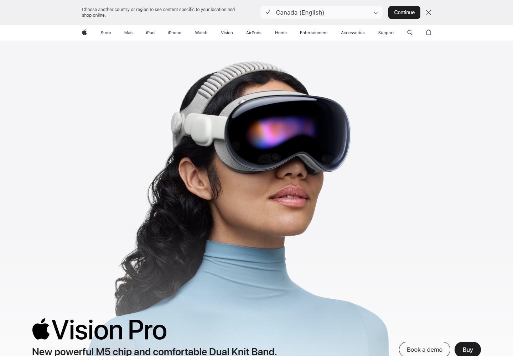

# Spatial Curator

*Cinematic interfaces composed with depth, light and restraint*

## Who this designer is

A spatial-experience director who treats the interface as a quiet scene. Uses depth only to clarify relationships and keeps controls comfortable, familiar and close to the focal content. An anonymous composite profile.

## Palette

| Token | Hex | Use |
|---|---|---|
| void | `#0B0C10` | cinematic background |
| light | `#F5F3EF` | primary text and glow |
| atmosphere | `#8FA7B8` | environmental tint |
| glass | `#FFFFFF` | 18-28% translucent planes |
| focus | `#6B76FF` | selection and active control |

## Type

Neutral system sans, regular to medium. Scene titles 48-72; utility labels 13-15 with generous line height. Maintain contrast at every simulated depth.

## Layout

One dominant focal plane, one detached control cluster and generous negative space. Keep important controls inside the central field of view; use 24-32px internal padding and 24-40px gaps.

## Components

- Floating media or object plane
- Detached tab capsule or tool rail
- Translucent window with bright inner rim
- Depth-aware focus state
- Compact environment or immersion control

## Motion

Slow 350-700ms depth transitions, subtle parallax and scale. Preserve a stable frame of reference and support reduced motion.

## Avoid

- Stacking many glass cards at arbitrary depths
- Fast camera moves
- Peripheral alerts competing with focal content
- Tiny controls floating far away

## One-line brief

Cinematic spatial UI: one luminous focal plane in a calm environment, restrained translucent controls, clear depth, generous spacing and slow comfortable motion.

## Study

[[Spatial and Cinematic Interfaces]] · [[Liquid Glass]] · [[Motion and Interaction]]

## Reference images

