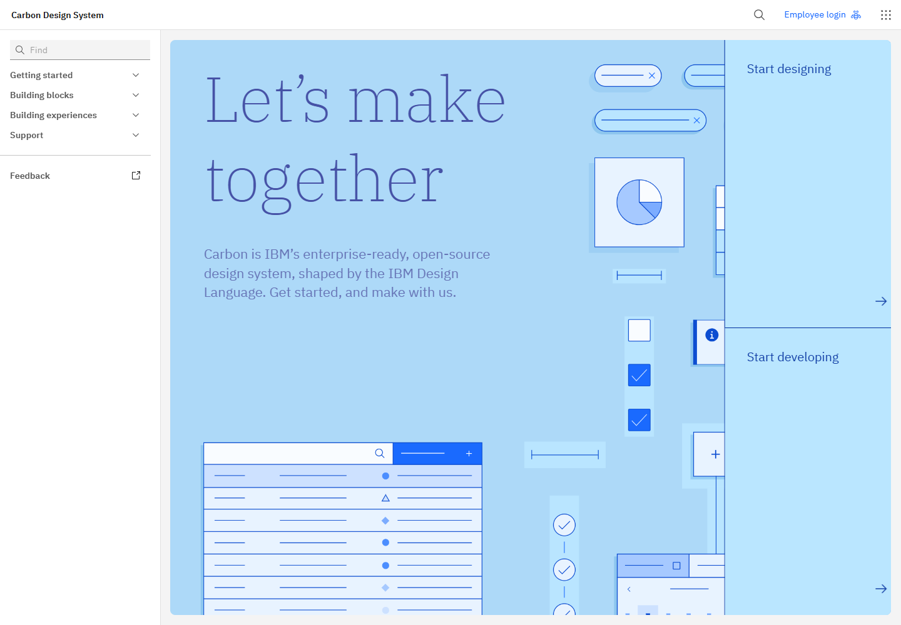
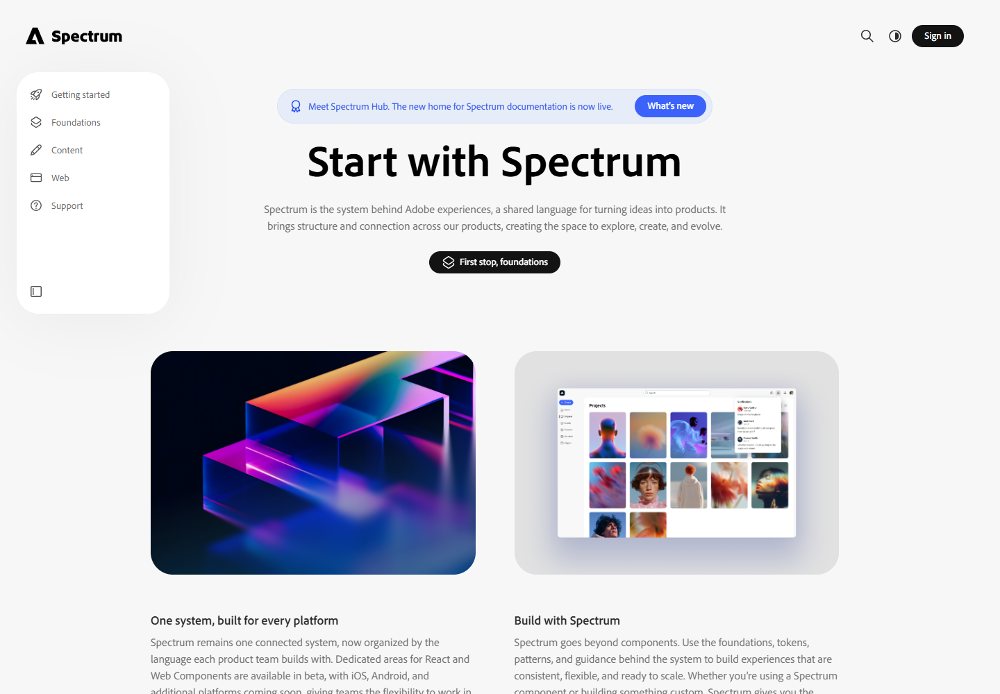

# System Steward

*Token-led product design with complete component states*

## Who this designer is

A systems-minded product designer who cares as much about error, empty and loading states as the hero screen. Builds coherent rules that survive many teams and platforms. An anonymous composite profile.

## Palette

| Token | Hex | Use |
|---|---|---|
| bg | `#FFFFFF` | base surface |
| layer | `#F4F4F4` | grouped content |
| ink | `#161616` | primary text |
| action | `#0F62FE` | primary and focus |
| danger | `#DA1E28` | destructive and error |
| success | `#198038` | confirmation |

## Type

Neutral UI sans with named tokens: display, heading, body, label, helper and code. Use tabular figures for data and preserve hierarchy across compact density modes.

## Layout

Use an 8px base grid, explicit container widths and predictable page templates. Dense screens rely on alignment, section headings and table rhythm rather than nested cards.

## Components

- Button and field with complete interaction states
- Data table with selection, sorting and empty state
- Inline notification and error summary
- Skeleton and progress patterns
- Theme and density tokens
- Anatomy and usage annotations

## Motion

Tokenized durations: 100ms micro feedback, 200ms component transitions, 300ms structural changes. Motion communicates causality.

## Avoid

- One-off spacing values
- Components without failure states
- Literal colour token names in product code
- Excessive variants with no decision guidance

## One-line brief

Systematic product UI: semantic tokens, disciplined 8px grid, complete component states, compact data patterns and documented interaction behavior.

## Study

[[Component Systems and States]] · [[Accessible and Inclusive UI]] · [[Fintech and Dashboards]]

## Reference images

