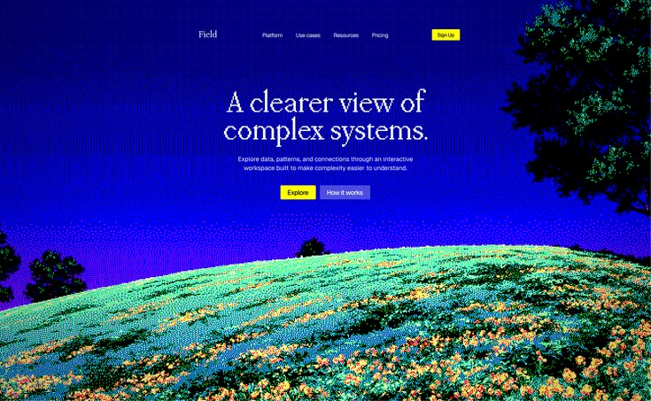
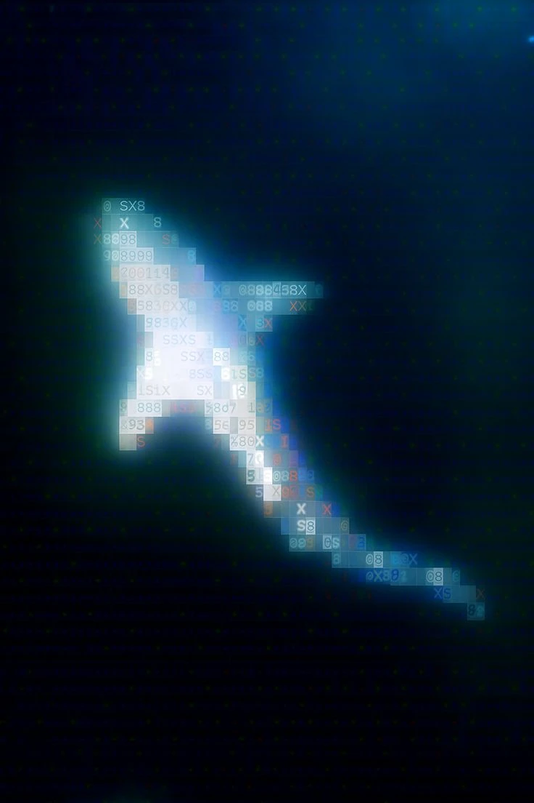

# Terminal Monk

*ASCII, dithering and mono type: the techie art-house look*

## Who this designer is

A creative technologist who builds their own dither tools. Loves 1-bit images, character art and terminal metadata. Every pixel is on purpose. (An anonymous composite persona; see [[Designers]] for the real-world research behind it.)

## Palette

| Token | Hex | Use |
|---|---|---|
| bg | `#0A0A0A` | or paper #F4F4F2 for light mode |
| ink | `#F4F4F2` | on dark |
| electric | `#2F3BE0` | dither duotone |
| pale | `#9FB8E8` | dither highlights |
| terminal | `#39E58C` | status only |
| cream | `#E8E1CC` | warm dither band |

## Type

Monospace everywhere (JetBrains Mono, Berkeley Mono-like). Dot-matrix or LED display face for big numbers. Tiny 10-11 uppercase metadata rows.

## Layout

Strict character grid; align to 8px. Thin 1px rules, square corners (radius 0-4). Bracketed labels like [ 01 ] and key/value rows.

## Components

- Hero art: a photo or object turned into a dither or ASCII field
- Dot-matrix numerals for stats
- Terminal-style input with blinking caret
- Mono key/value spec tables

## Motion

Stepped, frame-by-frame; type-on, scramble-in text; no easing curves.

## Avoid

- Soft shadows and big radii
- More than two hues
- Decorative gradients (use dither bands instead)

## One-line brief

ASCII/dither aesthetic: 1-bit or duotone dithered hero art, monospace and dot-matrix type, square corners, terminal metadata rows.

## Study

[[ASCII and Dither]] · [[Minimal Tech]]

## Reference images

