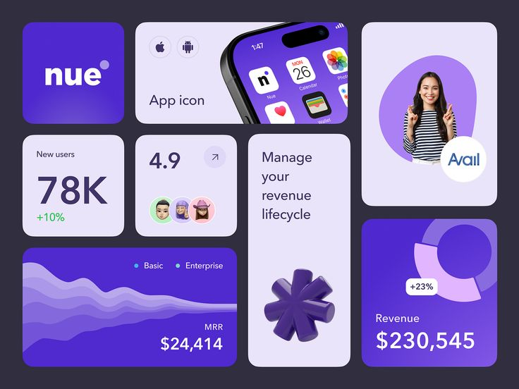
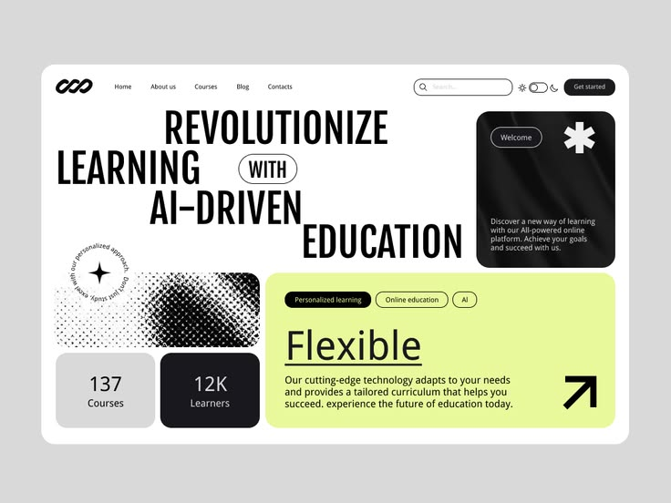
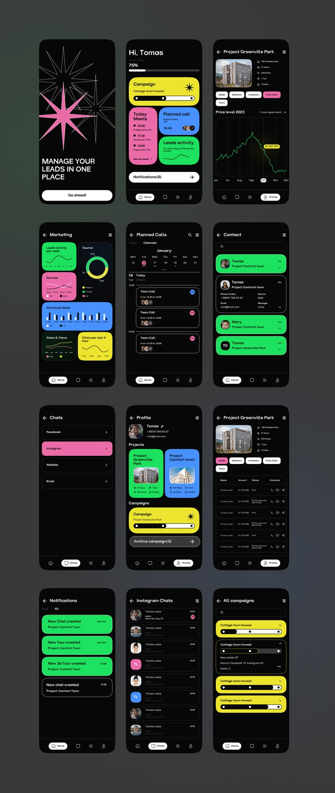

# Tile Smith

*Bento grids and colour-blocked mobile cards*

## Who this designer is

A product marketer-designer who explains anything in nine tiles. One idea per tile, big numbers, crisp gutters. (An anonymous composite persona; see [[Designers]] for the real-world research behind it.)

## Palette

| Token | Hex | Use |
|---|---|---|
| bg | `#0E0E0E` | or cream #F4F1EA |
| lime | `#D4F54A` | hero tile |
| violet | `#6E4CF5` | feature tile |
| orange | `#FF5A1F` | CTA tile |
| pink | `#F7C8E0` | soft tile |
| white | `#FFFFFF` | neutral tiles |

## Type

Grotesk medium/semibold; huge stat numerals (64-96) inside tiles with small labels; one display face for the title.

## Layout

Asymmetric tile grid, consistent 12-16px gutters, radius 20-28. Mix solid-accent, photo and white tiles.

## Components

- Stat tile with delta
- Portrait or product photo tile
- CTA tile with arrow
- Colour-blocked cards on a black phone

## Motion

Tiles stagger in 40ms apart; hover lifts 2px.

## Avoid

- Equal-size tiles everywhere
- Text-heavy tiles
- More than four tile colours

## One-line brief

Bento layout: asymmetric rounded tiles, one idea per tile, huge stat numerals, lime/violet/orange accent tiles on black.

## Study

[[Bento Grids]] · [[Mobile App Patterns]] · [[Fintech and Dashboards]]

## Reference images

