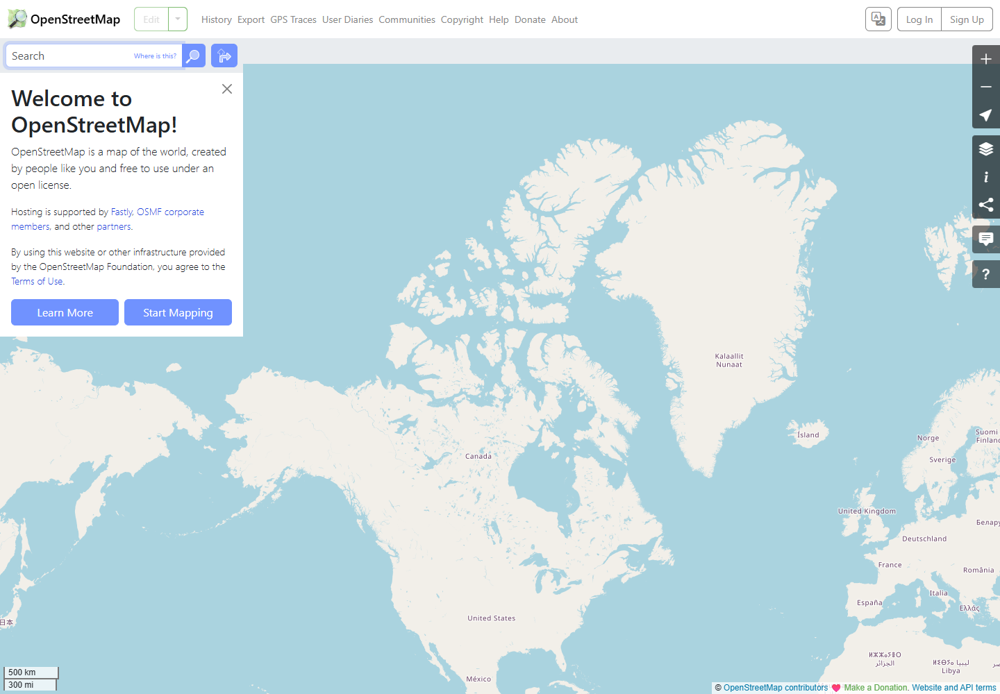
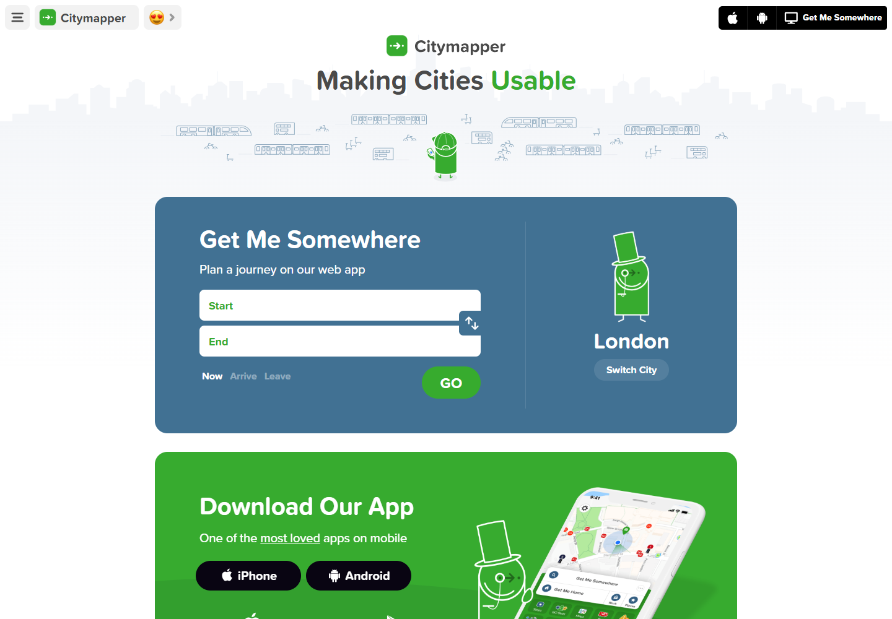

# Wayfinder

*Map-first navigation with decisive route and status hierarchy*

## Who this designer is

An information designer focused on movement through real places. Removes map noise, foregrounds the next decision and assumes the user may be walking, rushing or offline. An anonymous composite profile.

## Palette

| Token | Hex | Use |
|---|---|---|
| land | `#F4F1E8` | map ground |
| water | `#B8D7E8` | hydrography |
| ink | `#20242A` | labels |
| route | `#2EB82E` | active path |
| location | `#3B6FF5` | current position |
| disruption | `#E5484D` | service issue with text |

## Type

Highly legible sans with tabular times. Next action 28-36 semibold; arrival time 20-24; map labels 11-14 at controlled density.

## Layout

Map fills the canvas. A bottom sheet or side rail holds search, route summary and steps. The selected route and current location dominate all other geographic marks.

## Components

- Search with recent places
- Mode selector with icon and text
- Route options with duration and disruption
- Step card with direction and distance
- Live-location marker with uncertainty
- Collapsible itinerary sheet

## Motion

Map movement uses predictable ease and preserves orientation. Route changes animate locally; never spin or jump the camera without explanation.

## Avoid

- Equal emphasis for every map layer
- Tiny floating buttons
- Colour-only transport lines
- Hiding disruptions or arrival time

## One-line brief

Map-first wayfinding UI: quiet cartography, dominant active route, tabular arrival times, redundant mode cues and a compact persistent journey sheet.

## Study

[[Maps and Wayfinding]] · [[Accessible and Inclusive UI]] · [[Mobile App Patterns]]

## Reference images

